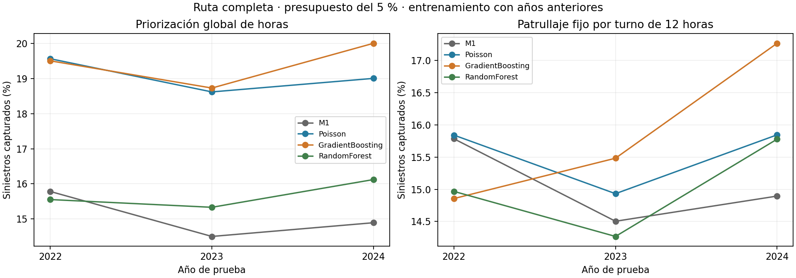
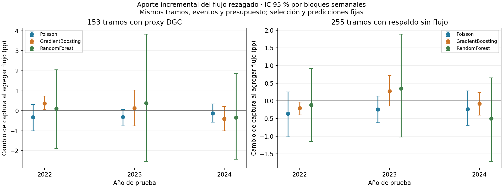
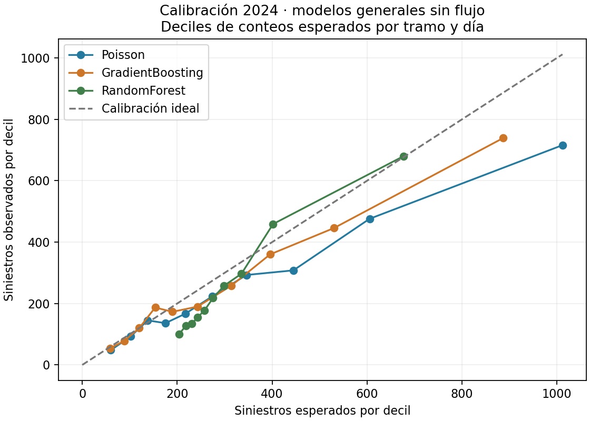
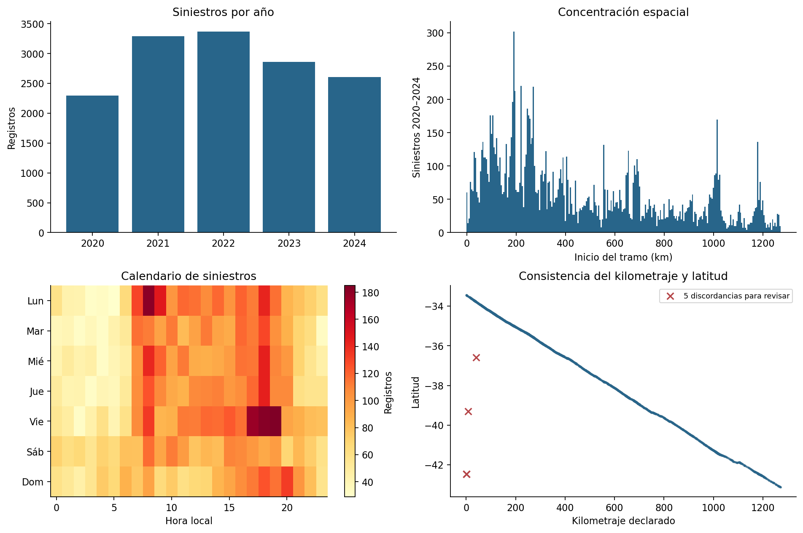
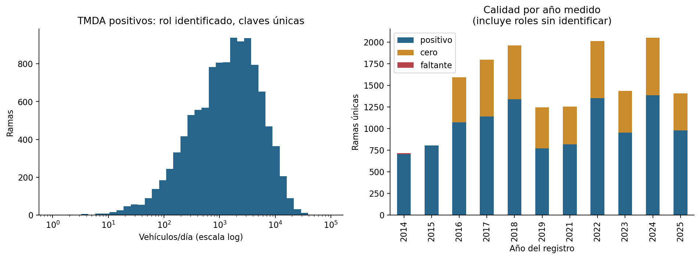
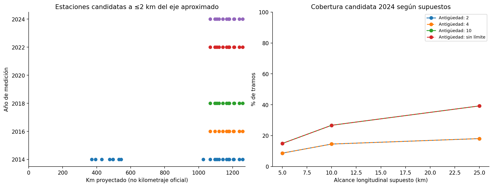
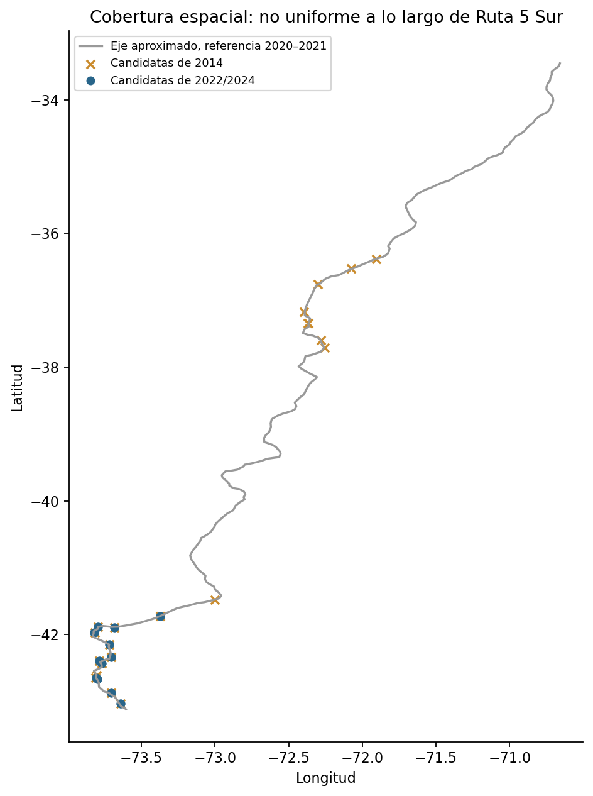
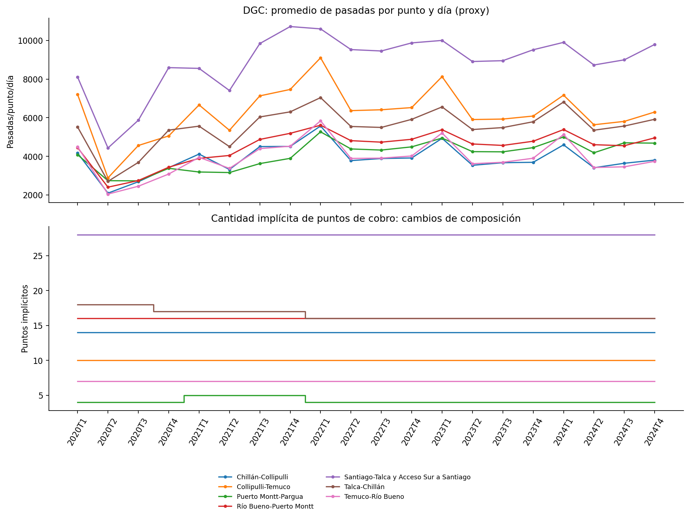
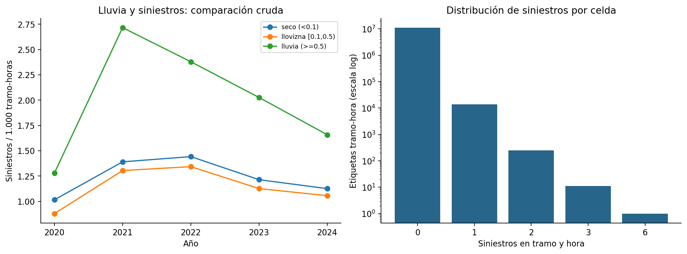

# Siniestros de tránsito en autopistas de Chile

## Autoría y asistencia de Codex

Por defecto, los commits con trabajo realizado con Codex mantienen al integrante del
equipo como autor principal e incluyen la siguiente coautoría:

```text
Co-authored-by: Codex <noreply@openai.com>
```

Esta identidad corresponde a la cuenta [Codex](https://github.com/codex). La regla para
futuros cambios está en [AGENTS.md](AGENTS.md) y se aplica solo cuando Codex contribuya
al contenido del commit. A petición del equipo, un commit realizado por Codex también
puede registrarlo como autor principal y al integrante como coautor. La identidad del
usuario que publica el commit (committer) y su autenticación permanecen separadas de
esa atribución. El historial publicado conserva sus autores originales.
GitHub documenta este mecanismo en [commits con varios autores](https://docs.github.com/en/pull-requests/how-tos/commit-changes/creating-a-commit-with-multiple-authors).

## Mantenimiento automático del repositorio

El **13 de noviembre de 2026** se configuró la tarea **Revisar y mantener proyecto de
siniestros**, asociada al chat del proyecto, con revisiones **cada cuatro horas**.
El equipo autorizó corregir problemas concretos, comprobar los cambios y publicarlos
directamente en `main`, actualizando este README con los avances y sus verificaciones.

La tarea revisa código, pruebas y documentación; conserva el trabajo local ajeno y el
alcance científico acordado. Si no hay una mejora justificada, no genera commits.
Notebook y presentación continúan para la fase final; los entrenamientos completos
no se repiten por rutina. Las instrucciones duraderas están en [AGENTS.md](AGENTS.md).

La tarea local requiere **el equipo encendido y la aplicación de escritorio abierta**.
Se puede revisar, cambiar o pausar desde la sección de tareas programadas de la
aplicación. Véase la [documentación oficial de tareas programadas](https://learn.chatgpt.com/docs/automations).
La autenticación se conserva en el llavero del equipo, fuera del repositorio.

## Plan de cierre técnico en dos días

El **13 de noviembre de 2026** se preparó una
[planificación en PDF para los cuatro integrantes](output/pdf/Plan_cierre_tecnico_2_dias.pdf),
basada en el estado del proyecto del commit `4533870`, la rúbrica de la Etapa III y
las observaciones del profesor. Organiza dos jornadas de siete horas, con entregables,
revisiones cruzadas y criterios de aceptación:

- **Diego:** integración, comprobación de código, reproducción y coherencia del README.
- **Vicente:** trazabilidad, cobertura, unidades y límites del flujo vehicular.
- **Martín:** justificación del modelo final, versiones del artefacto e interpretación.
- **Cristóbal:** comparación temporal, métricas, aporte de lluvia/flujo y conclusiones.

El documento prioriza cerrar la evidencia existente y corregir errores concretos;
no propone repetir entrenamientos completos sin motivo. Máximo conserva la presentación
y el notebook se prepara después del cierre técnico. Los horarios y las tareas son
una propuesta de organización, **no un registro de trabajos ya ejecutados**. Esta
actualización añade planificación; no modifica modelos, datos ni resultados.

Se contrastaron las cifras de referencia con las salidas del repositorio y se revisó
visualmente el PDF de ocho páginas. La planificación distingue los logros actuales de
la exposición vehicular y la validación con pronósticos históricos aún pendientes.

## Avance de Diego: reproducción e integración

**13 de noviembre de 2026.** Se completó la comprobación técnica inicial de Diego:

- Instalación aislada comprobada con Python 3.12.14 y versiones fijadas en
  [requirements-reproduccion.txt](requirements-reproduccion.txt). Se resolvió la
  incompatibilidad de Matplotlib 3.8.3 con NumPy 2 usando Matplotlib 3.9.4;
  `pip check` confirma un entorno sin conflictos.
- Se añadió [verificar_cierre.py](verificar_cierre.py): comprueba integridad de código
  y datos, cohortes, métricas, búsqueda/selección temporal y recalibración.
  El modo `--con-artefactos` reproduce las nueve métricas de la candidata en
  2023/2024 y comprueba 1.000 predicciones del reajuste, sin reentrenar.
- **40 pruebas aprobadas** con fuentes locales: las 33 originales más siete que
  detectan corrupción de tablas, mezcla de poblaciones y uso de información futura.
- Se identificaron como históricos los comandos y afirmaciones del prototipo
  anterior. La interfaz no se ha sincronizado con la candidata actual.

La [ficha de reproducción de Diego](docs/cierre/01_reproducibilidad.md) contiene
instalación, insumos fuera de Git, comandos, verificación y pendientes humanos.
La evidencia está en [verificacion_local.md](resultados/cierre/verificacion_local.md).
La revisión cruzada de Martín y la integración de las fichas de los otros integrantes
siguen pendientes. Notebook y presentación continúan para el cierre posterior.

Comprobación rápida desde la raíz del repositorio, después de instalar dependencias:

```bash
.venv/bin/python -m pip check
OMP_NUM_THREADS=2 OPENBLAS_NUM_THREADS=2 MPLCONFIGDIR=/tmp/siniestros-matplotlib .venv/bin/python -m unittest discover -s tests -v
.venv/bin/python verificar_cierre.py
```

Una copia de Git permite comprobar las tablas; la prueba del anexo DGC real se omite
si no está descargado (39 aprobadas y una omitida). La comprobación de predicciones
requiere fuentes originales y artefactos locales, como explica la ficha.

## Desarrollo de la Entrega 3

<!-- INICIO_MODELOS_ENTREGA3 -->
### Entrenamiento posterior al EDA: modelos con flujo vehicular

**Actualización: 12 de noviembre de 2026.** Se completó la comparación de Poisson,
Gradient Boosting y Random Forest con datos depurados, ERA5, calendario y proxy de
flujo DGC rezagado. El notebook y la presentación quedan para la etapa final.
La población de este experimento es **14.420 siniestros y 255 tramos**: se mantienen las
fuentes originales y se ponen en cuarentena las cinco discordancias espaciales del EDA.
Se usa un umbral de 25 km respecto de la referencia histórica; los umbrales de 5 y
10 km del EDA señalaban los mismos cinco registros. No se corrige su ubicación por
suposición. Los experimentos anteriores de 14.425
registros se conservan; sus puntuaciones no son comparaciones directas con esta corrida.

#### Incorporación del flujo y cambios de código

- [integrar_flujo.py](integrar_flujo.py) documenta intervalos interiores de seis contratos
  de Ruta 5, excluye baipases de kilometraje propio, fronteras inciertas y aplica margen
  de 1 km. Fuentes y páginas están en [limites_documentados.csv](resultados/modelos/limites_documentados.csv).
  Es una asignación de contexto por contrato; no acredita flujo uniforme por tramo.
- Se incorporan dos atributos: logaritmo del proxy diario de pasadas por punto de cobro
  y logaritmo del número implícito de puntos, ambos de **dos trimestres antes**.
  El segundo controla parcialmente cambios de composición; no verifica físicamente las plazas.
  Se normalizan a entero únicamente residuos ≤`1e-6` en puntos inferidos: el error
  máximo encontrado fue `7,3e-9`. Se conserva `puntos_implicitos_crudos` y cualquier
  fracción real. Así los árboles no aprenden cortes artificiales entre 4 y 4+`1e-9`.
  Se extraen también 2018–2019 de los XLS originales para tener rezagos reales desde 2020.
  Nunca se usa el flujo del trimestre a predecir ni se completan huecos con cero.
- Hay serie completa para **153/255 tramos (60 %)**; en 2024 contienen **1.491/2.605
  siniestros (57,24 %)**. Santiago–Talca/Acceso Sur, Chiloé y las celdas excluidas quedan
  fuera del experimento directo con flujo. El modelo híbrido usa un especialista en los
  tramos cubiertos y un modelo general sin flujo en los demás, con respaldo si falta el dato.
- PNCV continúa separado: sus estaciones parciales, ceros sin interpretar y falta de año
  2020 no se convierten en una exposición completa. `exposicion_validada.csv` permanece
  vacía. **Se modelan conteos; no se estima riesgo por vehículo-km.**
- [datos_modelado.py](datos_modelado.py) alinea las fuentes, mantiene la referencia espacial
  de 2020–2021, verifica las celdas del caché ERA5 tras la cuarentena y conserva exposición
  horaria 0/1/2 por horario de verano. La agrupación conserva conteos y exposición.
- [modelos_conteo.py](modelos_conteo.py) implementa las tres familias con pérdida/criterio
  Poisson. La regresión incluye offset horario y penalización L2; GB usa categorías nativas;
  RF usa categorías codificadas, 80 árboles y un máximo de 80.000 filas agrupadas por árbol.
  GB/RF ajustan tasa con peso igual a exposición y luego recuperan el conteo esperado.
  Sus tamaños de hoja y muestreo operan sobre filas agrupadas, no sobre horas individuales.
  Se aplica un piso de tasa de `1e-12` para calcular desvianza finita en hojas con cero.

#### Protocolo temporal y selección

Se comparan M0 uniforme, M1 espacial y las familias propuestas. En la cohorte de flujo,
cada familia tiene calendario → calendario+lluvia → calendario+lluvia+flujo sobre las
mismas filas. Incluyen tramo, hora, día de semana, mes, posición de feriado y tendencia
numérica anual; las variantes agregan lluvia y flujo. Las transformaciones se ajustan
solo con entrenamiento. No se usa una categoría de año futuro sin aprender.

1. Prueba 2022: entrenamiento 2020–2021, configuración simple prefijada.
2. Prueba 2023: entrenamiento 2020–2022, configuración elegida con 2022.
3. Prueba 2024: entrenamiento 2020–2023, configuración elegida con 2022 y 2023.

Se evalúan dos configuraciones por familia en los años previos, con preferencia por la
más simple a ≤0,1 puntos de captura del mejor promedio. La elección entre soluciones
para toda la ruta también usa exclusivamente las puntuaciones de 2022/2023.
**Candidata resultante: `Poisson_clima`**. La grilla, parámetros elegidos, años usados,
diagnósticos, versiones y hashes están en [auditoria.json](resultados/modelos/auditoria.json).

| Solución | Promedio captura 2022/2023 |
|---|---|
| GradientBoosting_clima | 19,11 % |
| Hibrido_GradientBoosting_clima | 18,81 % |
| Hibrido_GradientBoosting_clima_flujo | 18,85 % |
| Hibrido_Poisson_clima | 19,08 % |
| Hibrido_Poisson_clima_flujo | 18,78 % |
| Hibrido_RandomForest_clima | 15,79 % |
| Hibrido_RandomForest_clima_flujo | 15,90 % |
| M1 | 15,14 % |
| Poisson_clima | 19,09 % |
| RandomForest_clima | 15,44 % |

2024 ya se había inspeccionado en las entregas y el EDA: se informa como evaluación
histórica reutilizada, no como prueba intacta. Los intervalos usan 2.000 remuestreos
semanales pareados, manteniendo fijas predicciones y selección; no incorporan incertidumbre
del reentrenamiento ni corrigen comparaciones múltiples.

#### Resultados: ruta completa, prueba histórica de 2024

| Modelo | Captura 5 % | Captura por turno | Observado/esperado | MAE por turno |
|---|---|---|---|---|
| M1 | 14,89 % | 14,89 % | 0,88 | 1,8613 |
| M0 | 5,00 % | 5,00 % | 0,88 | 1,8613 |
| Poisson_clima | 19,00 % | 15,84 % | 0,77 | 1,9703 |
| GradientBoosting_clima | 20,00 % | 17,26 % | 0,87 | 1,7518 |
| RandomForest_clima | 16,12 % | 15,78 % | 0,83 | 1,8615 |

La candidata `Poisson_clima` captura **19,00 %** de
los siniestros con el 5 % del presupuesto global, frente a **14,89 %**
de M1. Su captura con patrullaje fijo por turno es **15,84 %**.
Son decisiones distintas: la priorización global permite cambiar tramo cada hora;
la métrica por turno fija los tramos durante 12 horas de reloj local. Observado/esperado
cercano a 1 indica mejor calibración agregada; no garantiza calibración por segmento.
El MAE compara el total de siniestros de la cohorte por turno de 12 horas.
Las métricas train/prueba, captura al 5/10/20 %, desvianza y MAE se conservan completas en
[metricas.csv](resultados/modelos/metricas.csv).
Diferencia frente a M1: 4,11 pp, IC 95 % [2,10; 6,08] pp.


Comparación train/prueba con la misma definición de captura:

| Modelo | Captura train (2020–2023) | Captura prueba (2024) | Brecha (pp) |
|---|---|---|---|
| GradientBoosting_clima | 26,01 % | 20,00 % | 6,01 |
| Poisson_clima | 21,72 % | 19,00 % | 2,72 |
| RandomForest_clima | 20,25 % | 16,12 % | 4,12 |

La brecha es un diagnóstico de generalización, no una prueba aislada de sobreajuste:
también cambian las frecuencias entre años. La elección se basa en evaluación temporal,
no en la captura obtenida durante el entrenamiento.



#### Aporte específico del flujo

Comparación 2024 sobre los mismos 153 tramos cubiertos (captura global y por turno al 5 %):

| Familia | Sin flujo | Con flujo | Turno sin flujo | Turno con flujo |
|---|---|---|---|---|
| Poisson | 17,51 % | 17,37 % | 15,03 % | 15,12 % |
| GradientBoosting | 18,85 % | 18,44 % | 16,06 % | 15,99 % |
| RandomForest | 15,36 % | 15,02 % | 13,62 % | 14,54 % |

La integración en toda la ruta tiene su propia comparación (255 tramos, captura al 5 %):

| Familia | General sin flujo | Híbrido sin flujo | Híbrido con flujo |
|---|---|---|---|
| Poisson | 19,00 % | 19,19 % | 18,96 % |
| GradientBoosting | 20,00 % | 20,31 % | 20,23 % |
| RandomForest | 16,12 % | 16,51 % | 16,01 % |

El híbrido sin flujo controla el efecto de entrenar un especialista en la cohorte
cubierta. Una mejora dentro de los 153 tramos no garantiza una mejora del ranking
entre todos los tramos; también interviene la escala relativa de sus predicciones.

Diferencia **clima+flujo menos clima**, sin confundirla con el aporte de la lluvia:

| Año | Familia | Cambio de captura (pp) | IC 95 % (pp) |
|---|---|---|---|
| 2022 | Poisson | -0,32 | [-1,01; 0,31] |
| 2022 | GradientBoosting | 0,37 | [0,06; 0,74] |
| 2022 | RandomForest | 0,11 | [-1,90; 2,05] |
| 2023 | Poisson | -0,32 | [-0,75; 0,06] |
| 2023 | GradientBoosting | 0,13 | [-0,76; 1,03] |
| 2023 | RandomForest | 0,38 | [-2,54; 3,82] |
| 2024 | Poisson | -0,13 | [-0,58; 0,34] |
| 2024 | GradientBoosting | -0,40 | [-1,01; 0,21] |
| 2024 | RandomForest | -0,34 | [-2,42; 1,86] |

Un intervalo que incluye cero no permite sostener una mejora clara en ese año.
No se da por útil el flujo solo por haberlo añadido; también puede reducir la captura.
Las comparaciones equivalentes para el híbrido de toda la ruta y contra M1 se guardan
en [bootstrap.csv](resultados/modelos/bootstrap.csv).




#### Recalibración de conteos con información previa

Para la candidata seleccionada se evalúa también multiplicar todos los conteos por el
cociente observado/esperado fuera de muestra del año anterior. Se mantiene fijo el
protocolo: 2023 usa el factor de 2022 y 2024 el de 2023. No se elige entre original y
recalibrado mirando el año objetivo. Un factor global positivo conserva el ranking,
la captura global y la captura por turno; sí cambia el volumen esperado y su MAE.

| Año | Variante | Año del factor | Factor | Observado/esperado | MAE por turno |
|---|---|---|---|---|---|
| 2023 | original | — | 1,0000 | 0,67 | 2,5360 |
| 2023 | recalibrado | 2022 | 0,6932 | 0,96 | 1,7840 |
| 2024 | original | — | 1,0000 | 0,77 | 1,9703 |
| 2024 | recalibrado | 2023 | 0,6687 | 1,15 | 1,6839 |

El ajuste puede mejorar o empeorar según el año; no demuestra estabilidad operativa.
Esta comparación es retrospectiva para la candidata elegida con 2022/2023, y la fila de
2023 forma parte del período usado para elegirla. Resultados completos en
[recalibracion_candidato.csv](resultados/modelos/recalibracion_candidato.csv).


#### Artefactos, reproducción y límites pendientes

Se guardaron modelos por año, cohorte y variante en `resultados/modelos/artefactos/`
(archivos locales ignorados por Git). Los evaluados en 2024 solo se ajustaron hasta 2023.
Se reajustó `Poisson_clima` con 2020–2024, conservando la elección y parámetros
anteriores a 2024. Su artefacto está en `resultados/modelos/artefactos/candidato_reajustado2020_2024.joblib`;
se verificaron 1000 predicciones reales idénticas al recargarlo.
Este reajuste no tiene evaluación futura y no sustituye el modelo del prototipo.
Se conserva además una variante recalibrada con el O/E fuera de muestra de 2024
en `candidato_reajustado2020_2024_recalibrado_con2024.joblib`; tampoco tiene evaluación futura.

Con las fuentes descargadas, ejecutar desde la raíz del repositorio:

```bash
OMP_NUM_THREADS=2 OPENBLAS_NUM_THREADS=2 .venv/bin/python entrenar_comparacion.py
OMP_NUM_THREADS=2 OPENBLAS_NUM_THREADS=2 .venv/bin/python reajustar_candidato.py
MPLCONFIGDIR=/tmp/siniestros-matplotlib .venv/bin/python resumir_modelos.py --actualizar-readme
OMP_NUM_THREADS=2 OPENBLAS_NUM_THREADS=2 .venv/bin/python -m unittest discover -s tests -v
```

**Comprobación de la corrida del 12 de noviembre: 33 pruebas pasaron.** Incluyen captura con empates y presupuesto,
UTC/DST, calendario fuera de cobertura, calidad de fuentes, fronteras de contratos,
rezago temporal, selección sin usar el año de prueba y persistencia de las tres familias.
La prueba nueva comprueba que se eliminan residuos numéricos de puntos de cobro sin
redondear fracciones reales. Se repitieron las variantes de flujo después de esta
corrección con [reentrenar_flujo.py](reentrenar_flujo.py), verificando hashes antes de
conservar los ajustes sin flujo. La corrida completa desde cero ya incluye el arreglo.

Siguen abiertas la validación con pronósticos meteorológicos emitidos en el pasado,
la fecha real de disponibilidad de los anexos DGC y la exposición vehicular por tramo.
El rezago de dos trimestres deja un trimestre completo desde el cierre de medición,
pero no acredita cuándo se publicó cada dato; los anexos actuales pueden contener revisiones.
Estos modelos respaldan una evaluación retrospectiva de conteos, no un servicio operativo
validado ni una interpretación causal del flujo. El calendario y las fuentes deben
actualizarse antes de una predicción fuera de 2020–2024.

La bitácora del EDA que sigue conserva las decisiones y pendientes de esa etapa.
Esta sección documenta su tratamiento posterior. No se modificaron notebook ni presentación.
<!-- FIN_MODELOS_ENTREGA3 -->

<!-- INICIO_EDA_ENTREGA3 -->
### Bitácora del EDA previo al entrenamiento

**Fase exploratoria: 12 de noviembre de 2026.** Esta sección conserva el diagnóstico
y las decisiones al cerrar el EDA, antes de la comparación posterior de modelos.
Las corridas anteriores se conservan como comprobación de las correcciones de código.
No se entrenaron modelos durante este EDA; su código tampoco ejecuta el entrenamiento.

El análisis se reproduce sin red con:

```bash
.venv/bin/python explorar_datos.py --actualizar-readme
```

Requiere las fuentes ya descargadas. Su código está en [explorar_datos.py](explorar_datos.py)
y las tablas y figuras en [resultados/eda](resultados/eda/). Se lee cada versión original,
se registran hashes y no se modifican las fuentes ni las salidas de los modelos.

#### 1. Siniestros: población y calidad

- Ruta 5 Sur: 14.430 registros; se conservan 14.425 tras excluir cinco con km inválido.
  El filtro `km > 0` conserva la decisión anterior de tratar cero como ubicación desconocida;
  no demuestra que todo cero de kilometraje sea físicamente imposible.
- 0 IDs duplicados, 0 faltantes en campos críticos,
  0 discrepancias entre lesionados totales y su desglose, y
  0 registros con severidad negativa. Campos completos no prueban
  exhaustividad del registro ni ausencia de subregistro.
- La hora está redondeada: 93,9 % de minutos son múltiplos de cinco;
  82,4 % de kilómetros son enteros. Se mantiene resolución horaria y de 5 km.
- 6,8 % de eventos se etiquetan urbanos. El 10,2 %
  de tramos con más eventos concentra 29,0 % del total
  (26 tramos de 255). No se eliminan eventos graves ni tramos extremos por ser infrecuentes.
- **Se detectan 5 discordancias importantes entre kilómetro y coordenadas.**
  Se obtienen las mismas cinco banderas con umbrales de 5, 10 y 25 km respecto del punto
  histórico del tramo; la distancia máxima es 1.037 km.
  Una correlación global alta no detectaba este problema. Las filas están identificadas
  en [siniestros_discordancia_km_coordenadas.csv](resultados/eda/siniestros_discordancia_km_coordenadas.csv).
  No se cambian kilómetros, rutas ni coordenadas por suposición y no se borran del conjunto
  principal durante este EDA: requieren revisar el registro de origen antes de reentrenar.
- La referencia espacial usa exclusivamente 2020–2021; es una aproximación de medianas e
  interpolaciones, no un eje vial oficial. Se usa para explorar cobertura, no para certificar
  la pertenencia de una estación a una rama concreta.



#### 2. PNCV del MOP: año medido, ceros y duplicaciones

- Se obtuvieron 18.289 filas con texto no vacío en rol a partir de seis capas
  (incluye marcadores y códigos sin identificar, no solo rutas identificadas).
  Son 16.265 claves distintas estación–rama–año–rol; las versiones
  no se suman como mediciones independientes.
- Hay 5.603 TMDA iguales a cero y 16 faltantes
  en las filas originales con rol. Cero se conserva como **valor sin interpretar**, no se
  equipara automáticamente a ausencia de circulación ni se reemplaza por un flujo positivo.
- De esos ceros, 5.538 tienen rol marcador, principalmente `-`:
  no se deben tratar como mediciones de carreteras identificadas sin tráfico. Se cruzan
  estado de rol y TMDA antes de describir la distribución. Ruta 5 tiene
  3 faltantes en sus claves únicas.
- Se detectan 2.016 claves repetidas entre capas,
  0 con TMDA contradictorio en esas claves.
  Los resúmenes de distribución usan claves únicas; se conserva la procedencia original.
- 0 coordenadas fuera del rango de comprobación y
  704 ramas con TMDA positivo pero rol vacío.
  Estar dentro del rango de Chile no valida la posición exacta en la carretera.
- **No hay registros con año de medición 2020 en esta descarga.** La capa titulada
  `2020 Sur - 2021 Norte` contiene 2021 y 2022; no se cambian esos registros a 2020.
  El problema está en la correspondencia título/contenido de la fuente y queda documentado.

| Capa | Título publicado | Años en los registros | Filas fuera de años del título |
|---|---|---|---:|
| 0 | 2024 Sur - 2025 Norte | 2024,2025 | 0 |
| 1 | 2022 Sur - 2023 Norte | 2022,2023 | 0 |
| 2 | 2020 Sur - 2021 Norte | 2021,2022 | 2.016 |
| 3 | 2018 Sur - 2019 Norte | 2018,2019 | 0 |
| 4 | 2016 Sur - 2017 Norte | 2016,2017 | 0 |
| 5 | 2014 Sur - 2015 Norte | 2014,2015 | 0 |

TMDA tiene asimetría y extremos: se inspeccionan positivos en escala logarítmica y se
guardan los 20 mayores para revisión. Un extremo no se elimina sin evidencia de error.



#### 3. Cobertura espacial y antigüedad: no basta con encontrar una estación cercana

La exploración mantiene solo estaciones a un máximo de 2 km del eje aproximado y prueba
alcances longitudinales de 5, 10 y 25 km, con antigüedades máximas de 2, 4 y 10 años y
sin límite. Son supuestos de sensibilidad, no radios acreditados de representatividad.
La geometría de referencia es la misma para todas las comparaciones.

Ejemplo para 2024, con alcance longitudinal supuesto de 10 km:

| Antigüedad máxima (años) | Tramos candidatos | % de tramos | % de siniestros de 2024 en ellos |
|---|---:|---:|---:|
| 2 | 37/255 | 14,5 % | 6,4 % |
| 4 | 37/255 | 14,5 % | 6,4 % |
| 10 | 68/255 | 26,7 % | 18,7 % |
| sin_limite | 68/255 | 26,7 % | 18,7 % |

Las estaciones recientes cercanas se concentran en la parte sur del corredor; parte de
la cobertura aparente del resto proviene de mediciones antiguas. Los resultados no se
deben extrapolar a todos los tramos ni a la hora punta. Año de medición anterior al evento
no acredita que el dato estuviera publicado antes de predecir. Las fechas de disponibilidad
siguen sin acreditarse en las 18.289 filas de ramas.




#### 4. Concesiones: versiones, períodos y unidades

- Los anexos 2023T4 y 2024T4 aportan 252 filas de siete contratos del
  sur. Se solapan en 112 contrato-trimestres; sumarlos duplicaría esos períodos.
- En el solapamiento se detectaron 0 revisiones de transacciones
  y 0 revisiones de promedios por punto. Que estas dos versiones coincidan no
  acredita disponibilidad histórica ni descarta revisiones en otras versiones.
- Para descripción se conserva la versión más reciente por contrato y trimestre:
  140 observaciones (7 contratos × 20 trimestres, 2020–2024),
  0 períodos faltantes. La versión usada queda en cada fila.
- Se distinguen **pasadas trimestrales** y **promedio mensual por punto de cobro**.
  `promedio mensual × 3 / días del trimestre` es un proxy diario por punto, no TMDA
  por tramo ni número de vehículos únicos. No se suman los promedios de siete contratos
  para inventar un tránsito medio de toda la ruta.
- `pasadas trimestrales / (3 × promedio mensual por punto)` permite revisar la cantidad
  implícita de puntos. Cambia en dos contratos; puede alterar las comparaciones de totales:

- Puerto Montt-Pargua: 2021T1, 5 puntos implícitos (cambia respecto al trimestre anterior).
- Puerto Montt-Pargua: 2022T1, 4 puntos implícitos (cambia respecto al trimestre anterior).
- Talca-Chillán: 2020T4, 17 puntos implícitos (cambia respecto al trimestre anterior).
- Talca-Chillán: 2022T1, 16 puntos implícitos (cambia respecto al trimestre anterior).

Estas cantidades son inferidas algebraicamente de los anexos, no una verificación física
de apertura/cierre de plazas. Los crecimientos interanuales se entregan junto con los
cambios de puntos para no atribuirlos automáticamente a circulación.

Santiago–Talca incluye Acceso Sur. Los contratos del sur disponibles no equivalen por sí
solos al universo de 255 tramos, que también incluye Chiloé. No se correlacionaron conteos
por tramo con flujo por contrato sin una correspondencia vial comprobada.



#### 5. Clima nuevo y variable de conteo

- ERA5 explícito: 59 celdas para 255 tramos; 43.848
  etiquetas horarias de 2020–2024. Se comprobaron alineación temporal y exposición DST.
- Hay 5 etiquetas de hora inexistente y
  5 repetidas. Los 295 NaN
  estructurales de ERA5 corresponden a las horas inexistentes en sus celdas;
  0 faltantes en horas que sí existen y
  0 siniestros registrados en horas inexistentes.
- 81,0 % de las etiquetas tramo-hora existentes tienen
  0 mm; máximo 11,2 mm/h. Se conservan los extremos.
- Los umbrales implementados con `np.digitize` son exactamente: seco `<0,1`, llovizna
  `0,1 ≤ p < 0,5`, lluvia `p ≥ 0,5` mm/h. El texto anterior `>0,5` no describía
  exactamente la frontera del código; la categoría de 0,5 se aclara sin cambiar el corte.
- 99,87 % de celdas sin siniestros. Los ceros abundantes
  no bastan para elegir una familia probabilística. El perfil crudo por lluvia se entrega
  sin ajuste espacial, de calendario o de flujo y no prueba un efecto causal.
- El reanálisis describe condiciones históricas; no certifica una predicción con el
  pronóstico que habría estado disponible 12 horas antes. Varios tramos comparten celda
  ERA5: repetirla no agrega observaciones meteorológicas independientes.
- Calendario: 243 fechas marcadas en la fuente, 242
  dentro de 2020–2024. Se describen días y siniestros por posición en feriado, incluyendo
  días sin eventos. La primera fecha marcada es 2019-12-31 y la última
  2024-12-25; esos extremos no prueban exhaustividad de los feriados legales.
  No se extrapola el calendario a 2026.



#### Decisiones y pendientes registrados al cerrar el EDA

1. Mantener PNCV y DGC separados: unidad estación/rama/año versus contrato/trimestre.
2. Revisar los cinco siniestros con discordancia espacial y resolver su tratamiento;
   los filtros originales de kilometraje no bastaban para comprobar ubicación.
3. Resolver el año faltante 2020 y documentar antigüedad/fechas de publicación antes de
   proponer exposición histórica. No renombrar mediciones para completar una serie.
4. Construir o conseguir una correspondencia documentada estación/rama o contrato →
   tramo. La cercanía y los límites de una concesión no prueban un flujo homogéneo.
5. Aclarar los ceros de TMDA y los cambios de puntos de cobro; mantener faltantes como tales.
6. Mantener vacía la tabla de exposición validada mientras estas cuestiones sigan abiertas.
   No se ha estimado todavía riesgo por vehículo-km ni se declara validado un modelo final.
7. Después, retomar el protocolo temporal, comparación GB/RF e interpretación. El EDA
   inspecciona también 2024, por lo que ese año no se debe presentar como una prueba intacta.

#### Registro de avances y cambios

| Fase | Avance | Estado al cerrar el EDA |
|---|---|---|
| Revisión inicial | Cruce de propuesta, presentación, rúbrica y retroalimentación; plan de Entrega 3 | Documentado |
| Correcciones de código | Captura con empates/presupuesto, convergencia, limpieza común, referencia desde pasado, UTC/DST y calendario | Implementadas y comprobadas |
| Comprobación técnica anterior | Corridas M0/M1/M2/M3, train/prueba, bootstrap de lluvia, turnos y recalibración con año previo | Diagnóstico previo; no selección final |
| Descarga y preparación | Seis capas PNCV, dos anexos DGC y ERA5; procedencia y versiones preservadas | Completadas |
| EDA actual | Calidad, duplicaciones, años, antigüedad, cobertura, unidades, cambios de composición y clima | Ejecutado; limitaciones abiertas descritas arriba |
| Exposición vehicular | Correspondencia por tramo, representatividad y disponibilidad histórica | Pendiente de resolver |
| Comparación y elección de modelos | GB/RF y evaluación final según el plan | En espera del análisis de datos |
| Comunicación | Notebook y presentación | Para el final, por indicación del equipo |

El EDA no modificó el notebook, la presentación, las fuentes descargadas ni los artefactos
de ajuste. Los resultados anteriores se conservan sin convertirlos en evidencia nueva.
<!-- FIN_EDA_ENTREGA3 -->


### Código preparado y comprobaciones anteriores

Los comandos de evaluación siguientes permiten reproducir las comprobaciones técnicas
anteriores. El EDA no los ejecuta. La comparación posterior con flujo se documenta
en la sección de entrenamiento y utiliza scripts y salidas separados.

La evaluación corregida se ejecuta desde código Python. El notebook y la presentación
se actualizarán al cerrar los experimentos. La página publicada sigue siendo el prototipo
anterior y sus cifras no representan esta nueva corrida.

```bash
python3 -m venv .venv --system-site-packages
.venv/bin/python -m pip install -r requirements.txt
.venv/bin/python -m unittest discover -s tests -v
.venv/bin/python feriados.py
.venv/bin/python clima.py
OPENBLAS_NUM_THREADS=2 OMP_NUM_THREADS=2 .venv/bin/python validar_ruta5.py
.venv/bin/python flujo_vehicular.py --descargar
.venv/bin/python flujo_concesiones.py --descargar
```

`validar_ruta5.py --sin-clima --salida resultados/sin_clima` permite ejecutar M0/M1/M2
sin descargar meteorología. La validación completa compara las especificaciones originales
con L2 fijo, entrena con el pasado y evalúa 2022, 2023 y 2024. No presenta 2024 como un
conjunto intacto: ya fue inspeccionado en la entrega anterior. Estas comprobaciones no
incluyen el ajuste temporal de GB/RF ni la selección posterior, documentados en la sección
de entrenamiento con flujo.

Cambios de evaluación:

- Una sola implementación de captura en `evaluacion.py`: presupuesto exacto en horas
  expuestas, selección fraccionaria uniforme dentro de empates y M0 sobre la diagonal.
- Métricas de entrenamiento y prueba con la misma definición; bootstrap semanal pareado
  tanto para M3−M1 como para **M3−M2**, que aísla el aporte de lluvia sobre el calendario.
- Captura global y captura de tramos fijos por turnos de 12 etiquetas horarias locales se
  reportan separadamente. Estos turnos pueden durar 11/13 horas reales en cambios de hora.
- Conteos, MAE por ventana y calibración por deciles acompañan al ranking. La variante
  `M3_recalibrado` aplica el cociente observado/esperado fuera de muestra del año previo;
  no se corrige usando el total del año que se está evaluando. Puede empeorar y se reporta.
- El optimizador debe converger antes de devolver coeficientes. Los diagnósticos, filtros,
  versiones y hashes de entrada se guardan en `resultados/validacion/auditoria.json`.

Datos y clima:

- `datos_ruta5.py` centraliza la limpieza: 14.430 registros de ruta y 5 excluidos por km.
  El universo continuo de 255 tramos y la referencia meteorológica se construyen con
  2020–2021; los huecos interiores se interpolan, sin consultar eventos de prueba.
- `clima.py` usa `clima_utc.py`: fija `models=era5`, descarga UTC y une por timestamps de
  `America/Santiago`. Rechaza faltantes reales; no los convierte en lluvia cero. Conserva
  cachés parciales para reanudar la descarga. Cachés de la versión anterior deben regenerarse.
- CONASET no distingue los dos instantes de una hora repetida por cambio de horario.
  Se combinan sus conteos, con exposición de dos horas y precipitación media como
  aproximación declarada. Horas inexistentes tienen exposición cero; cualquier evento
  registrado en ellas se excluye y se contabiliza en la auditoría.
- `riesgo.py` usa UTC en la consulta de pronóstico y rechaza calendarios fuera de cobertura;
  la extracción histórica de feriados 2020–2024 no sirve para inferir los feriados de 2026.
  El modelo sigue estimando frecuencia esperada, sin atribuir asociaciones a causas.

Flujo vehicular:

- `flujo_vehicular.py` descarga las seis capas históricas del [PNCV del MOP](https://rest-sit.mop.gob.cl/arcgis/rest/services/VIALIDAD/Plan_Nacional_de_Censos/MapServer)
  por ID, comprueba integridad y conserva año **del registro**, rama, rol y fuente. Hay capas
  cuyo nombre no coincide con todos sus años: no se deducen años desde el título.
- Produce `ramas_mop.csv`, `candidatos_ruta5.csv` y `cobertura.csv` en `resultados/flujo/`.
  Una proximidad al eje histórico es un candidato de cobertura, no un flujo validado.
  No se suman ramas como sentidos ni se rellenan tramos sin observación.
- `flujo_concesiones.py` extrae los [anexos oficiales de DGC](https://concesiones.mop.gob.cl/publicaciones/)
  2023T4 y 2024T4, con siete contratos del sur. Conserva versión, trimestre y celda de
  origen y comprueba livianos + pesados = total. Los archivos distinguen transacciones
  trimestrales y pasadas mensuales promedio por punto de cobro. Son indicadores de flujo,
  **no vehículos-km**; Santiago-Talca también incluye Acceso Sur.
- Fechas de publicación histórica y correspondencia de rama/tramo no están acreditadas
  por el solo hecho de descargar estas fuentes hoy. Por eso los datos de flujo todavía
  no se usan como offset del modelo. `exposicion_vehiculo_km` permite incorporar una tabla
  documentada por tramo/año, valida fecha de disponibilidad y conserva NaN donde falta
  cobertura. La aproximación TMDA/24 supone uniformidad y no controla puntas horarias.

Los resultados de estas comprobaciones quedan en `resultados/validacion/metricas.csv`, `bootstrap.csv`
y `calibracion.csv`; las fuentes crudas y cachés son regenerables y están excluidas de Git.

## Prototipo y antecedentes de la entrega anterior

Este bloque conserva el prototipo y las cifras de la entrega anterior. Su universo
de Ruta 5 Sur (14.282 eventos y 251 tramos) difiere del experimento actual
(14.420 y 255). No usar sus capturas, coeficientes ni interfaz como evidencia de
la candidata nueva. La página no acredita inferencia operativa validada para 2026.

### [Ver el prototipo histórico](https://martinnmg1809.github.io/siniestros-transito-chile/)

Riesgo por tramo y hora en **10 carreteras de Chile**, recalculado en tu navegador con el
pronóstico de lluvia del momento. Sin servidor y sin cron: la ventana de 12 horas se
cuenta desde que abres la página.

Cada ruta trae dos vistas: **tira horaria** (bandas de km × 12 horas) y **mapa** a escala
real coloreado por riesgo, con un control para recorrer las horas. El pronóstico se pide
solo para la ruta que estás mirando y se cachea por hora, así el costo contra la cuota de
Open-Meteo no crece con el número de rutas.

Si Open-Meteo no responde, la página no se cae: calcula con calzada seca y lo advierte.

### Rutas publicadas

Captura = porcentaje de los siniestros reales de 2024 cubiertos al vigilar el 5 % de las
horas-tramo más riesgosas. «Solo ubicación» es el mapa estático, sin hora ni clima.

| Ruta | Siniestros 2020–2024 | Tramos | Captura top 5 % | Solo ubicación |
|---|---:|---|---:|---:|
| RUTA 5 SUR | 14.282 | 251 × 5 km | 19.1 % | 14.9 % |
| RUTA 5 NORTE | 5.765 | 208 × 10 km | 41.2 % | 37.6 % |
| RUTA 160 | 1.621 | 28 × 5 km | 29.1 % | 24.2 % |
| RUTA 68 | 1.382 | 22 × 5 km | 8.6 % | 4.8 % |
| I-50 | 1.243 | 25 × 5 km | 19.2 % | 14.5 % |
| RUTA 66 | 1.146 | 23 × 5 km | 23.9 % | 22.1 % |
| RUTA 180 | 747 | 12 × 5 km | 13.8 % | 8.7 % |
| 115 CH | 719 | 24 × 5 km | 32.7 % | 29.4 % |
| RUTA 57 | 701 | 14 × 5 km | 16.7 % | 13.2 % |
| 199 CH | 603 | 22 × 5 km | 13.4 % | 8.0 % |

**Cinco rutas quedaron fuera** aunque tenían datos suficientes: Ruta 78, 41 CH, F-30-E,
J-60 y Ruta 148. En todas ellas el modelo completo **no supera al mapa estático** en la
validación sobre 2024, es decir, sumar hora, día, feriado y clima aporta ruido en vez de
señal. Publicarlas como predicción dinámica sería falso.

Otras tres se descartaron antes, en la limpieza: Ruta 60 CH y Ruta 7 porque su kilometraje
no describe la posición sobre la ruta ni después de corregir unidades (correlación 0,57 y
0,85), y Ruta 150 por tener solo 5 tramos.

---

## Factibilidad: análisis y predicción de siniestros en autopistas

Informe de factibilidad basado en **datos reales verificados el 2026-09-01** consultando
directamente las APIs públicas. Todas las cifras de este documento fueron obtenidas
ejecutando consultas contra los servicios, no de documentación.

---

## 1. Resumen ejecutivo

| Pregunta | Respuesta |
|---|---|
| ¿Hay datos suficientes? | **Sí.** 436.521 siniestros georreferenciados 2020–2025, acceso público sin API key. |
| ¿Autopista con más datos? | **Ruta 5 Sur** — 14.430 siniestros (2020–2024), 20.980 sumando Ruta 5 Norte y Ruta 57. |
| ¿Qué es más factible construir? | **Mapa de puntos calientes por kilómetro** (alta factibilidad, resultado garantizado). |
| ¿Predicción de accidentes? | **Factible con restricciones** — requiere generar casos negativos y datos de exposición (TMDA). Ver §5. |
| Cuello de botella principal | El clima (`Estado_Atm`) **solo existe para 2023**; hay que reconstruirlo desde una API meteorológica externa. |

**Recomendación:** construir un producto en dos capas sobre Ruta 5 Sur —
(1) mapa de calor por tramo de km, (2) modelo de *riesgo relativo* por hora × día × clima
como capa explicativa sobre ese mapa. Ver §6.

---

## 2. Fuente principal: ArcGIS Hub de CONASET

CONASET publica 106 servicios ArcGIS abiertos, sin autenticación, consultables por REST
(`f=json`, filtros SQL, paginación, `outStatistics`). Es la mejor fuente de Chile por lejos:
son los datos de Carabineros (SIEC 2) ya geocodificados.

- Portal: https://mapas-conaset.opendata.arcgis.com/
- Endpoint raíz: `https://services3.arcgis.com/vaJl1B5HEzZj7154/arcgis/rest/services`

### Capa recomendada: `Base_SINIESTROS_2020_2025`

**436.521 registros.** Es la única capa que combina cobertura nacional multi-año,
coordenadas, kilometraje de ruta y variables temporales.

Distribución anual verificada:

| Año | Siniestros |
|---|---|
| 2020 | 58.823 |
| 2021 | 78.405 |
| 2022 | 82.953 |
| 2023 | 75.303 |
| 2024 | 72.043 |
| 2025 | 68.994 |

Zona: **RURAL 96.290** (carreteras) / **URBANA 340.231**.

Campos disponibles:

```
FID, ID, AÑO, FECHA, Dia_semana, Mes, Hora, Hora_aprox, REGION, PROVINCIA, COMUNA,
TIPO_SINIE, TIPO__CONA, ZONA, CAUSA_SINI, CAUSA_NUEV, UBICACION, Calle_Uno, Calle_Dos,
Número, Ruta, Ubicación, Dirección, FALLECIDOS, TOTAL_LESI, GRAVES, MENOS_GRAV, LEVES,
Siniestro, Latitud, longitud, Zonas_urb_, Atropello, Bicicleta, Motociclet, AM
```

Dos campos son la clave del proyecto:
- **`Ruta`** — nombre de la carretera (`RUTA 5 SUR`, `RUTA 68`, `RUTA 160`…)
- **`Ubicación`** — **el kilómetro exacto sobre la ruta** (ej. 191,5). Esto permite
  referenciación lineal, que es exactamente lo que se necesita para hotspots en autopista.

### Otras capas útiles

| Servicio | Registros | Para qué sirve |
|---|---|---|
| `base_feriados` | 49.016 | Siniestros con `Feriado`, `Nombreferiado`, `Dia_del_feriado`. **Resuelve el requisito "festividades" sin trabajo extra.** |
| `Puntos_criticos_2020_2025` | 283.971 | Puntos críticos ya agregados por CONASET (útil como *baseline* de validación). |
| `tramos_con_siniestro` | 95.523 | Polilíneas de tramos viales con indicador de siniestralidad. |
| `rutas_con_indicador` | 2.359 | Ejes de rutas por ROL, para dibujar la carretera en el mapa. |
| `Siniestros_individuales_REGION_*_2023` | por región | **Únicas capas con clima**: `Estado_Atm`, `Condición` (calzada), `Estado_Cal`, `Tipo_Calza`, `Intersecci`. |
| `Base_de_persona_vehiculo_4` | 770.414 | Nivel persona/vehículo: edad, sexo, calidad (conductor/pasajero/peatón). |
| `Rural_2020` … `Rural_2024` | ~15.800/año | Solo zona rural, limpio. |
| `Reporte_diario_2025`, `Reporte_diario_2026` | diario | Datos casi en tiempo real de fallecidos. |

---

## 3. La autopista con más datos: **Ruta 5**

Conteo verificado agrupando por el campo `Ruta` (2020–2024):

| Ruta | Siniestros |
|---|---|
| **RUTA 5 SUR** | **14.430** |
| RUTA 5 NORTE | 5.845 |
| RUTA 160 | 1.633 |
| RUTA 68 (Santiago–Valparaíso) | 1.387 |
| RUTA 60 CH | 1.251 |
| I-50 | 1.250 |
| RUTA 66 (Autopista del Sol) | 1.151 |
| RUTA 78 | 855 |
| RUTA 180 | 755 |

Ruta 5 Sur tiene **2,5× más datos que la siguiente** y 8,8× más que Ruta 68. No hay competencia.

### Calidad de los datos de Ruta 5 (extraídos y perfilados en este directorio)

Archivo: [`ruta5_2020_2024.csv.gz`](ruta5_2020_2024.csv.gz) — 20.980 registros (`Ruta LIKE 'RUTA 5%'`).

- **100 % tienen latitud/longitud** (20.980 de 20.980) — sin geocodificación pendiente.
- **99,97 % tienen kilómetro válido** (14.425 de 14.430 en Ruta 5 Sur, tras filtrar km > 2.200).
- 1.184 fallecidos, 17.982 lesionados, 1.008 siniestros fatales.
- Cobertura territorial: Maule 4.151, Coquimbo 2.548, Los Lagos 2.409, O'Higgins 2.353,
  La Araucanía 2.068, RM 1.541, Valparaíso 1.197, Ñuble 1.176.

Tipos: COLISION 8.022 · CHOQUE 7.975 · VOLCADURA 3.605 · ATROPELLO 583.
Causas: DISTRACCION 6.275 · VELOCIDAD IMPRUDENTE 4.364 · IMPRUDENCIA 3.502 ·
ALCOHOL 1.655 · FALLAS MECANICAS 1.276 · FATIGA 987.

### Prueba de concepto de hotspots ya ejecutada

Agrupando Ruta 5 Sur en tramos de 5 km (255 tramos con al menos un siniestro):

| Tramo (km) | Siniestros | Fallecidos |
|---|---|---|
| 190–195 | 302 | 8 |
| 220–225 | 220 | 2 |
| **270–275** | 219 | **17** |
| 195–200 | 213 | 6 |
| 185–190 | 196 | 4 |
| 245–250 | 186 | 9 |
| 105–110 | 176 | 5 |
| 95–100 | 176 | 7 |
| 250–255 | 176 | 12 |
| 255–260 | 171 | 13 |
| 1015–1020 | 170 | 4 |

El mapa de puntos calientes **ya funciona**: la señal es fuerte, concentrada y estable.
El tramo 270–275 (zona Talca/San Rafael) destaca por letalidad, no solo por frecuencia.

---

## 4. Estado de cada variable que quieres usar

| Variable | ¿Está? | Detalle |
|---|---|---|
| **Fecha** | ✅ Completa | `FECHA`, `AÑO`, `Mes`, `Dia_semana` en todos los registros. |
| **Hora** | ✅ Completa | `Hora` (hh:mm:ss) y `Hora_aprox` (0–23). |
| **Día de la semana** | ✅ Completa | Ya viene calculado. Viernes es el día peak (3.448 de 20.980). |
| **Festividades** | ✅ Vía `base_feriados` | 49.016 registros con nombre del feriado y día del fin de semana largo. Alternativa: generar el calendario de feriados legales de Chile. |
| **Ubicación** | ✅ Completa | Lat/lon + kilómetro de ruta. |
| **Clima** | ⚠️ **Parcial** | `Estado_Atm` (DESPEJADO / NUBLADO / LLUVIA / LLOVIZNA / NEBLINA) y `Condición` de calzada (SECO / MOJADO / HUMEDO) **solo en las capas regionales de 2023**. Para 2020–2025 hay que reconstruirlo. |
| **Flujo vehicular (exposición)** | ⚠️ Externa | No está en CONASET. Ver §5. |

### Solución para el clima: API de reanálisis horario

Verificado y funcionando: **Open-Meteo Historical Weather API** (ERA5, gratuita, sin API key,
resolución horaria, cobertura global desde 1940). Se hace *join* por `(lat, lon, fecha, hora)`:

```bash
curl "https://archive-api.open-meteo.com/v1/archive?latitude=-34.99&longitude=-71.23&start_date=2020-01-03&end_date=2020-01-03&hourly=temperature_2m,precipitation,visibility,wind_speed_10m&timezone=America/Santiago"
```

Devuelve temperatura, precipitación, visibilidad y viento hora a hora. Con esto se
reconstruye clima para los 20.980 siniestros de Ruta 5 y, más importante, **para las horas
en que NO hubo accidentes** — que es lo que un modelo predictivo necesita.

Alternativas nacionales (más fieles pero más trabajo): la
[API de Climatología de la DMC](https://climatologia.meteochile.gob.cl/) (estaciones EMA,
JSON) y el [Explorador Climático CR2](https://explorador.cr2.cl/). La DMC tiene menos
estaciones que puntos de la carretera, así que en la práctica hay que interpolar igual.

**Resultado de la validación (medido, no supuesto):** contrastando los 6.096 siniestros
de Biobío 2023 que sí traen `Estado_Atm` observado contra lo que dice ERA5 para esa misma
celda y hora:

| Métrica | Valor |
|---|---|
| Acuerdo global | 84,7 % |
| **Sensibilidad** | **47,2 %** |
| Precisión | 26,7 % |
| **Kappa de Cohen** | **0,262** |

**El reanálisis NO reproduce la observación de Carabineros.** Se pierde más de la mitad de
las lluvias registradas en terreno. La causa es estructural: ERA5 promedia sobre celdas de
~25 km y la lluvia en la zona centro-sur es localizada, así que un chubasco sobre la
carretera se diluye en la celda. Reproducir con esto el campo `Estado_Atm` para 2020-2025
**no es viable**.

Pero esa es una pregunta distinta a la que importa. Que ERA5 no reproduzca *la etiqueta*
no implica que la precipitación no *prediga siniestros*. Eso se midió por separado y la
respuesta fue la contraria — ver §6.

---

## 5. El problema difícil: exposición y casos negativos

Este es el punto donde la mayoría de estos proyectos falla, así que conviene tenerlo claro
desde el principio.

**Los datos de CONASET solo contienen accidentes.** No hay filas de "km 191, martes 3 a. m.,
lloviendo, no pasó nada". Un modelo entrenado solo con accidentes no puede predecir
accidentes: aprende *dónde se concentran*, que es descriptivo, no predictivo.

Hay dos caminos legítimos:

**A) Modelo de conteos por celda espacio-temporal (recomendado).**
Se construye una grilla: tramo de 5 km × hora × día. Ruta 5 Sur ≈ 255 tramos × 24 h × 1.826 días
≈ 11,2 millones de celdas, la gran mayoría con cero siniestros. Se ajusta una regresión de
Poisson o binomial negativa (o gradient boosting con objetivo Poisson) sobre el conteo.
Esto responde exactamente tu pregunta — *"probabilidad de accidente según clima, hora,
día, feriado"* — y es estadísticamente correcto.

**B) Caso-cruzado (case-crossover).** Cada accidente se compara consigo mismo en horas
"control" del mismo tramo (ej. la misma hora las 3 semanas previas). Controla automáticamente
todo lo que no cambia en el tramo (curva, pendiente, señalización) y aísla el efecto del
clima y la hora. Es el diseño estándar en epidemiología del tránsito y **no requiere datos
de flujo vehicular**, lo que lo hace muy atractivo aquí.

**Exposición (TMDA):** el MOP publica el Plan Nacional de Censos Viales — 863 puntos censales
con Tránsito Medio Diario Anual por rama y por ROL de ruta, en un MapServer abierto:

```
https://rest-sit.mop.gob.cl/arcgis/rest/services/VIALIDAD/Plan_Nacional_de_Censos/MapServer
```

Capas por período: `2024 Sur - 2025 Norte`, `2023 Norte`, `2022 Sur - 2021 Norte`, etc.
Campos: `ROL_RAMA_1..4`, `TMDA_RAMA_1..4`, `ESTACION_DE_CONTROL`, `COMUNA`, `REGION`, `ANO`.
Sirve para normalizar "accidentes por millón de vehículos-km" en vez de accidentes crudos.
Limitación: es un promedio anual, no un flujo horario — no captura la punta de un domingo
de fin de semana largo.

---

## 6. Resultados históricos de la Entrega 2 (métrica anterior)

Los valores de esta sección se conservan como antecedente. La captura anterior tenía un
tratamiento incorrecto de empates y frontera de presupuesto; no utilizarla como resultado
vigente. La implementación y resultados corregidos están descritos al inicio de este README.

Modelo Poisson sobre la grilla tramo (5 km) × hora, 255 tramos × 43.848 horas =
**11,2 millones de celdas**. Validación **temporal**: entrena 2020-2023 (11.820 siniestros),
prueba 2024 (2.605). Nunca aleatoria — hay autocorrelación y una partición al azar infla
los resultados.

### ¿Predice?

La métrica es operativa: *si dedicas el N % de las horas-tramo disponibles a vigilar las de
mayor riesgo predicho, ¿qué porcentaje de los siniestros reales de 2024 cubres?*

| Modelo | Desvianza ↓ | top 5 % | top 10 % | top 20 % |
|---|---|---|---|---|
| Tasa constante | 0,0 % | 2,1 % | 5,7 % | 15,4 % |
| **Solo tramo** (mapa estático) | 4,1 % | **15,0 %** | 26,3 % | 43,5 % |
| + hora, día, mes, feriado | 4,7 % | 17,8 % | 29,4 % | 47,3 % |
| **+ clima** | **5,1 %** | **19,2 %** | **30,6 %** | 47,5 % |

**Lectura honesta: el componente espacial hace casi todo el trabajo.** El mapa estático ya
captura el 15 % de los siniestros en el 5 % del tiempo — tres veces mejor que el azar.
Agregar hora, día, feriado y clima lo sube a 19,2 %, una mejora relativa del 28 %. Es real
y vale la pena, pero no es transformadora: quien prometa que el modelo dinámico cambia el
juego respecto de un buen mapa de puntos calientes, está exagerando.

### Efectos estimados (multiplicadores sobre la celda promedio)

| Variable | Efecto |
|---|---|
| **Lluvia > 0,5 mm/h** | **2,12×** |
| Llovizna 0,1–0,5 mm/h | 1,31× |
| 18:00 | 1,70× |
| 09:00 / 15:00 | 1,29× |
| 03:00 | 0,54× |
| Día de salida de feriado (`inicio`) | 1,22× |
| Último día de feriado (`final`) | 1,17× |
| Día feriado intermedio | 0,93× |
| Viernes | 1,11× |

Tres hallazgos que no eran obvios:

1. **La lluvia es el factor más fuerte del modelo**, por encima de la hora punta. La medición
   del clima es ruidosa (§4); la dirección del sesgo resultante no está demostrada
   en este diseño. Es una asociación sin ajuste por flujo vehicular.
2. **El día de salida a un fin de semana largo es más peligroso que el feriado mismo**
   (1,22× vs 0,93×). Por eso conviene el campo `Dia_del_feriado` de CONASET, que marca el
   período completo, en vez de una lista de feriados legales.
3. **El día de la semana casi no aporta** (0,93–1,11×). La hora sí (3,1× entre las 03:00 y
   las 18:00). Si hay que elegir variables, la hora vale y el día no.

### Veredicto sobre qué construir

**🟢 Mapa de puntos calientes** — resuelto y validado. Es la base y aporta el grueso de la
señal.

**🟡 Capa dinámica de riesgo** — funciona, aporta un 28 % relativo sobre el mapa estático, y
su valor se concentra en los eventos de lluvia, que es justo cuando un panel alimentado por
pronóstico le gana a un mapa fijo.

**🔴 "Sistema que predice accidentes"** — sigue descartado, y ahora con números. La tasa base
es de **0,13 % por tramo-hora**; en toda la Ruta 5 Sur se esperan **3,95 siniestros en 12
horas**. Ningún modelo con estos datos dirá "mañana a las 15:20 en el km 193 habrá un
choque", y una interfaz que muestre "probabilidad: 1,5 %" por tramo no le sirve a nadie.
Lo que sí se puede mostrar es el conteo esperado de la ruta completa y el riesgo relativo
por tramo.

---

## 7. Plan de trabajo histórico de factibilidad

1. **Extracción.** `python3 descargar_conaset.py` — ya funciona, ya bajó los 20.980 registros.
2. **Limpieza.** Filtrar km implausibles (hay valores como 93.800 en el campo `Ubicación`),
   normalizar nombres de ruta, deduplicar por `ID`.
3. **Hotspots.** Agregación por tramo + índice de severidad + mapa. **Aquí ya hay resultado.**
4. **Enriquecimiento.** Join con Open-Meteo (clima horario) + `base_feriados` + TMDA del MOP.
5. **Validación del clima.** Contrastar Open-Meteo contra `Estado_Atm` de las capas
   regionales 2023. Reportar el nivel de acuerdo.
6. **Modelo.** Grilla tramo × hora × día, Poisson/binomial negativa. Validación temporal
   (entrenar 2020–2023, probar 2024) — nunca aleatoria, porque hay autocorrelación.
7. **Visualización.** Mapa interactivo con las dos capas.

### Limitaciones que conviene declarar en el informe final

- El campo `Ruta` **solo está poblado hasta 2024**. Los 68.994 registros de 2025 existen
  (17.201 rurales) pero sin nombre de ruta; habría que asignarlos espacialmente por cercanía
  al eje vial (`rutas_con_indicador`).
- Los datos son de Carabineros: **subregistro conocido** de siniestros sin lesionados y de
  siniestros donde no concurrió personal policial.
- El clima que reporta Carabineros es una observación subjetiva en terreno; el reanálisis es
  una estimación de modelo. Ninguno de los dos es una medición en el punto exacto.
- El TMDA es anual y por punto censal, no por tramo-hora.

---

## Contenido del repositorio

| Archivo | Qué es |
|---|---|
| `README.md` | Estado actual, reproducción y antecedentes de factibilidad. |
| `descargar_conaset.py` | Descarga cualquier capa del ArcGIS Hub de CONASET, con paginación. Sin API key. |
| `json_a_csv.py` | Convierte la salida a CSV comprimido (fechas epoch → ISO). |
| `hotspots.py` | Agrega Ruta 5 Sur en tramos de N km y ordena por frecuencia y letalidad. |
| `feriados.py` | Calendario de feriados de Chile 2019–2024 (243 fechas), con fin de semana largo completo. |
| `validar_clima.py` | Contrasta la reconstrucción ERA5 contra el clima observado por Carabineros (§4). |
| `clima.py` | Serie horaria de precipitación 2020–2024 para las 60 celdas ERA5 de la Ruta 5. |
| `modelo.py` | Modelo Poisson tramo × hora con validación temporal (§6). |
| `modelo_clima.py` | Igual, con precipitación, para medir cuánto aporta el clima. |
| `entrenar.py` | Ajusta el modelo final sobre 2020–2024 y guarda `modelo_final.json`. |
| `riesgo.py` | Combina el modelo con el pronóstico de Open-Meteo: riesgo por tramo y hora. |
| `generar_pagina.py` | Genera `pagina.html`: snapshot estático, para correr por cron cada hora. |
| `rutas.py` | Selecciona y limpia las rutas viables. Resuelve el kilometraje en unidades mezcladas. |
| `preparar.py` | Tramos, geometría, celdas de clima, ciudades y bandas por ruta. |
| `clima_rutas.py` | Precipitación horaria 2020–2024 de las 191 celdas ERA5 de todas las rutas. |
| `entrenar_rutas.py` | Un modelo por ruta, validación temporal y filtro contra el mapa estático. |
| `generar_multi.py` | Genera `index.html`: página en vivo con todas las rutas y sus dos vistas. |
| `generar_live.py` | Versión anterior de una sola ruta (Ruta 5 Sur). Se conserva como referencia. |
| `siniestros_rutas.csv.gz` | 82.026 siniestros con ruta asignada, 2020–2024. |
| `ciudades.json` | 11 ciudades de referencia sobre la ruta, derivadas de la comuna modal por zona. |
| `ruta5_2020_2024.csv.gz` | 20.980 siniestros de la Ruta 5 (2020–2024), 944 KB. |

### Reproducción histórica del prototipo

Estos comandos pertenecen al flujo anterior. Para la Entrega 3 usar la
[ficha de reproducción actual](docs/cierre/01_reproducibilidad.md); ejecutar el flujo
antiguo no reproduce la comparación con flujo ni exporta la candidata nueva.

```bash
python3 descargar_conaset.py --where "Ruta LIKE 'RUTA 5%'" --salida ruta5.json
python3 json_a_csv.py ruta5.json ruta5_2020_2024.csv.gz
python3 hotspots.py 5          # mapa estático
python3 feriados.py            # calendario -> feriados.json
python3 clima.py               # 60 llamadas, ~5 min -> clima_ruta5.npz
python3 modelo.py 5            # modelo y validación temporal
python3 modelo_clima.py        # cuánto aporta el clima

python3 entrenar.py            # modelo final -> modelo_final.json
python3 generar_pagina.py      # pronóstico + página -> pagina.html
```

Para las 10 rutas:

```bash
python3 descargar_conaset.py --where "Ruta IS NOT NULL AND Ruta<>''" --salida todas.json
python3 rutas.py todas.json    # selección y limpieza -> rutas.json
python3 preparar.py            # estructuras por ruta -> rutas_datos.json
python3 clima_rutas.py         # 191 celdas, ~40 min, resumible -> clima_rutas.npz
python3 entrenar_rutas.py      # un modelo por ruta -> modelos.json
python3 generar_multi.py       # página final -> index.html
```

Hay dos versiones de la página:

**`pagina.html`** — snapshot estático. Los números quedan horneados al generarla, así que
necesita un cron para mantenerse al día:

```
0 * * * * cd /ruta/al/repo && python3 generar_pagina.py
```

**`index.html`** — prototipo anterior con consulta en vivo. Embebe los 306 coeficientes del modelo y
el calendario de feriados (33 KB en total); el navegador pide el pronóstico a Open-Meteo
y recalcula su salida en cada visita. Esta descripción refleja su diseño original;
no certifica la vigencia del calendario embebido ni la validez de las próximas 12 horas.
Antes de una demostración actual deben sincronizarse modelo, fuentes y calendario.

Requiere un host estático donde el navegador pueda alcanzar `api.open-meteo.com`
(la API responde `access-control-allow-origin: *`). **No funciona embebida en un artifact
de claude.ai**, cuyo CSP bloquea todo host externo.

Publicada en GitHub Pages: <https://martinnmg1809.github.io/siniestros-transito-chile/>

La extracción y los hotspots corren con la biblioteca estándar. El modelo necesita
`numpy` y `scipy`.
El `.json` crudo está en `.gitignore` porque es regenerable y pesa 16 MB.

---

## 8. Fuentes

- [CONASET — Portal de mapas (ArcGIS Hub)](https://mapas-conaset.opendata.arcgis.com/)
- [CONASET — Observatorio de datos y estadísticas](https://www.conaset.cl/programa/observatorio-datos-estadistica/)
- [CONASET — Informe Nacional de Siniestros de Tránsito 2024](https://conaset.cl/wp-content/uploads/2025/07/Informe-nacional-de-siniestros-en-Chile-2024.pdf)
- [MOP Vialidad — Plan Nacional de Censos (REST)](https://rest-sit.mop.gob.cl/arcgis/rest/services/VIALIDAD/Plan_Nacional_de_Censos/MapServer)
- [MOP Vialidad — Plan Nacional de Censo Vial](https://vialidad.mop.gob.cl/plan-nacional-de-censo-vial/)
- [Open-Meteo — Historical Weather API](https://open-meteo.com/en/docs/historical-weather-api)
- [DMC — Portal de Servicios Climáticos](https://climatologia.meteochile.gob.cl/)
- [Explorador Climático CR2](https://explorador.cr2.cl/)
- [Portal de Datos Abiertos de Chile](https://datos.gob.cl/dataset?tags=tr%C3%A1nsito)
- [Carabineros — Anuario de Tránsito](https://www.carabineros.cl/secciones/anuarioTransito/)
