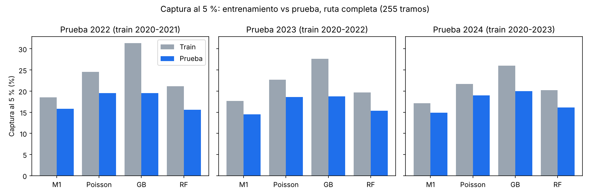
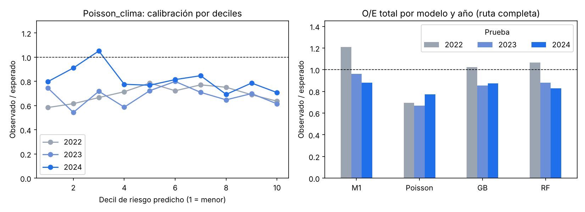

# Evaluación e interpretación · ficha de cierre

Proyecto: **Predicción dinámica de siniestros en carreteras chilenas**.

Estado: contenido técnico y documental completado el 14/11/2026 a petición de
Diego, con asistencia de Codex. Base: `72b2c98`. Las tablas, figuras y generadores
son aportes de Cristóbal en `07df973`, `dbe7ef7` y `3963bd3`; esta redacción y la
revisión de datos/flujo se completan por encargo de Diego. No se atribuye a
Cristóbal ni a Vicente una firma o revisión personal que no hayan registrado.

## 1. Pregunta, población y validación

La pregunta es dónde concentrar vigilancia y qué conteo esperar según tramo,
hora, calendario y lluvia. Se modelan siniestros por tramo de 5 km y hora, con
14.420 eventos limpios de 2020–2024 y 255 tramos de Ruta 5 Sur. Los cinco eventos
en cuarentena espacial siguen excluidos. El flujo es un proxy trimestral por
contrato disponible para 153 tramos; no es exposición por vehículo-km.

| Prueba histórica | Entrenamiento |
|---|---|
| 2022 | 2020–2021 |
| 2023 | 2020–2022 |
| 2024 | 2020–2023 |

La búsqueda y selección respetan años previos al objetivo. La selección final
usa 2022/2023 y la regla de simplicidad previamente fijada. **2024 es evaluación
histórica reutilizada**, pues se exploró en entregas anteriores. No se usa para
reseleccionar la familia. El reajuste 2020–2024 es un artefacto distinto del modelo
que se evaluó en 2024 y no tiene una evaluación posterior acreditada.

Evidencia: [comparación](../../resultados/cierre/comparacion_final.csv),
[selección temporal](../../resultados/modelos/seleccion_temporal.csv) y
[reproducción](01_reproducibilidad.md). La justificación de elección de Martín
corresponde a la ficha 03; esta ficha interpreta la evaluación disponible.

## 2. Qué mide cada resultado

- **Captura al 5 % global:** proporción de siniestros concentrados al priorizar el
  5 % del presupuesto de horas-tramo. No es accuracy ni probabilidad de accidente.
- **Captura por turno:** los tramos se mantienen fijos durante cada turno histórico
  de 12 horas de reloj local. Es una restricción más cercana a asignar vigilancia.
  La evaluación global puede cambiar de tramo por hora y no representa ese mismo plan.
- **O/E:** total observado dividido por total esperado. Menor que 1 indica
  sobreestimación del total; mayor que 1, subestimación. No describe por sí solo
  la calibración de cada tramo.
- **MAE por turno:** error absoluto medio del total de siniestros de la cohorte
  por turno de 12 h; su unidad es siniestros por turno. No es error por tramo.
- **Desvianza por hora:** evalúa conteos mediante la pérdida de Poisson; se compara
  dentro del mismo universo y exposición. Menor es mejor.

Los presupuestos y empates siguen la implementación de evaluación. La emisión
experimental del piloto usa doce horas reales en UTC y 12 tramos enteros de 255
(4,71 %). Esa emisión no reproduce exactamente el presupuesto fraccionario del
5 % ni los turnos de reloj local del estudio histórico; sus métricas no deben
intercambiarse sin una evaluación propia.

## 3. Comparación 2024 en la ruta completa

Todas las filas siguientes son prueba 2024, 255 tramos y 2.605 siniestros:

| Modelo | Captura global 5 % | Captura por turno 5 % | O/E | MAE total por turno |
|---|---:|---:|---:|---:|
| M0 | 5.00 % | 5.00 % | 0.880 | 1.861 |
| M1 | 14.89 % | 14.89 % | 0.880 | 1.861 |
| Poisson_clima | 19.00 % | 15.84 % | 0.772 | 1.970 |
| GradientBoosting_clima | 20.00 % | 17.26 % | 0.874 | 1.752 |
| RandomForest_clima | 16.12 % | 15.78 % | 0.829 | 1.862 |

Fuente: [métricas originales](../../resultados/modelos/metricas.csv).
M0 es la referencia uniforme y M1 la referencia espacial. Poisson_clima supera
la captura global de M1 en 4,11 puntos porcentuales, pero la diferencia por turno
es 0,95 puntos. Por ello, la ganancia global no se debe presentar como si fuera
la ganancia de un patrullaje fijo de 12 horas. GB presenta mejores métricas en
varias columnas de 2024; eso no habilita una elección posterior sobre este año.

Ejemplo de interpretación: una captura global de 19 % significa que la selección
histórica del presupuesto al 5 % concentró aproximadamente 19 de cada 100
siniestros del universo evaluado. No significa que 19 de cada 100 alertas sean
correctas. Un conteo esperado de 0,05 en un tramo tampoco asegura que allí ocurrirá
un siniestro ni expresa riesgo por conductor.

## 4. Generalización entre años

Poisson_clima obtiene 19,56 %, 18,62 % y 19,00 % de captura global en 2022–2024;
GB obtiene 19,50 %, 18,73 % y 20,00 %. La brecha media entrenamiento–prueba es
3,93 puntos en Poisson, 8,91 en GB y 4,69 en RF. En Poisson disminuye de 5,01
puntos en 2022 a 2,72 en 2024; en GB, de 11,83 a 6,01 puntos.

La pérdida fuera del entrenamiento es mayor en GB. Esa brecha es compatible con
sobreajuste y con cambios temporales, pero no identifica por sí sola su causa.
La estabilidad en tres años no garantiza desempeño en un período nuevo.
La media 2022–2024 es descriptiva y no se incorpora a la regla de selección.
Las brechas faltantes de los híbridos no son cero: no se entregó su partición train.

Evidencia: [generalización](../../resultados/cierre/generalizacion.csv),
[estabilidad](../../resultados/cierre/estabilidad_temporal.csv).

## 5. Cuánto aportan lluvia y flujo

Se compara clima contra calendario para aislar el aporte predictivo de lluvia,
y clima+flujo contra clima para estudiar el proxy. La comparación usa los mismos
153 tramos con contrato y 2.000 réplicas de bootstrap semanal pareado con
predicciones fijas. Las diferencias son puntos porcentuales de captura al 5 %.

| Aporte | Familia | Año | Diferencia (pp) | IC95 % (pp) |
|---|---|---:|---:|---|
| flujo | GradientBoosting | 2022 | +0.374 | [0.056; 0.737] |
| flujo | GradientBoosting | 2023 | +0.127 | [-0.757; 1.031] |
| flujo | GradientBoosting | 2024 | -0.402 | [-1.009; 0.210] |
| flujo | Poisson | 2022 | -0.321 | [-1.005; 0.309] |
| flujo | Poisson | 2023 | -0.317 | [-0.754; 0.064] |
| flujo | Poisson | 2024 | -0.134 | [-0.578; 0.340] |
| flujo | RandomForest | 2022 | +0.107 | [-1.897; 2.053] |
| flujo | RandomForest | 2023 | +0.380 | [-2.539; 3.825] |
| flujo | RandomForest | 2024 | -0.335 | [-2.421; 1.860] |
| lluvia | GradientBoosting | 2022 | +1.442 | [-0.169; 3.019] |
| lluvia | GradientBoosting | 2023 | +3.361 | [1.352; 5.520] |
| lluvia | GradientBoosting | 2024 | +2.347 | [-0.132; 4.920] |
| lluvia | Poisson | 2022 | +0.855 | [-0.807; 2.622] |
| lluvia | Poisson | 2023 | +1.522 | [-0.388; 3.498] |
| lluvia | Poisson | 2024 | +1.140 | [-1.240; 3.541] |
| lluvia | RandomForest | 2022 | -0.160 | [-2.209; 1.921] |
| lluvia | RandomForest | 2023 | +0.444 | [-1.978; 2.953] |
| lluvia | RandomForest | 2024 | +0.537 | [-2.223; 3.649] |

Fuente: [contrastes e intervalos](../../resultados/cierre/aporte_lluvia_flujo.csv),
derivados del [bootstrap original](../../resultados/modelos/bootstrap.csv).

La lluvia muestra una ganancia puntual positiva en Poisson en los tres años,
pero sus intervalos incluyen cero. GB 2023 muestra un incremento de 3,361 pp con
intervalo positivo. El flujo solo tiene un intervalo positivo en GB 2022 y su
estimación cambia de signo en 2024; no hay mejora consistente entre años.
Esto no demuestra que el tráfico real no importe: el predictor disponible es un
proxy agregado por contrato y trimestre. Los intervalos que incluyen cero tampoco
prueban igualdad. No se corrigieron por múltiples comparaciones ni se reentrenó
cada réplica, por lo que no abarcan toda la incertidumbre del desarrollo.

## 6. Calibración y cantidad de siniestros

Poisson original sobreestima el total en los tres años: O/E de 0,693, 0,669 y
0,772. El comportamiento por deciles no es uniforme, como muestra la figura.
El rótulo «riesgo predicho» corresponde al orden por conteo esperado tramo/hora.

| Prueba | Año del factor | O/E original → recalibrado | MAE original → recalibrado | Captura global |
|---|---|---|---|---|
| 2023 | 2022 | 0,669 → 0,965 | 2,536 → 1,784 | 18,62 %, sin cambio |
| 2024 | 2023 | 0,772 → 1,154 | 1,970 → 1,684 | 19,00 %, sin cambio |

Fuente: [recalibración](../../resultados/cierre/recalibracion_resumen.csv).
Un factor positivo común cambia el nivel de los conteos, conserva el orden y
por ello no mejora la captura. En 2024 mejora el MAE, pero pasa a subestimar el
total; no garantiza calibración futura. M1 sin recalibrar tiene MAE 1,861 en 2024:
no se ha comparado aquí con un M1 recalibrado por el mismo procedimiento.
El margen O/E [0,95; 1,05] usado para rotular «cercano a 1» en el resumen es
una convención descriptiva, no un intervalo estadístico ni umbral operativo.

## 7. Revisión de la ficha de Vicente

Se completó la revisión técnica de la [ficha 02](02_datos_flujo.md) por encargo
de Diego. El [registro de comprobación](../../resultados/cierre/revision_vicente.md)
conserva alcance, cifras y hashes de las tablas examinadas. Se verificaron cobertura,
faltantes, rezago, unidades del código de extracción, coincidencia de las cohortes,
residuos de puntos implícitos y hashes de los dos anexos originales.

La revisión respalda el uso del proxy para el experimento retrospectivo. No acredita
fechas de primera publicación ni TMDA/vehículo-km. Esas limitaciones continúan
explícitas y no se convierten en supuestos cumplidos al cerrar la documentación.

## 8. Conclusión y límites para la defensa

La solución aporta un ranking dinámico de conteos y supera la referencia espacial
en captura global histórica. La ganancia con tramos fijos por turno es menor y
la estimación del número total requiere atención a la calibración. La selección
temporal ya fijada mantiene Poisson_clima; corresponde a Martín cerrar su ficha
de elección y describir los artefactos finales.

El alcance verificable sigue siendo Ruta 5 Sur 2020–2024. 2025 se excluye por falta
de ubicación vial comparable acreditada. No se estima riesgo por vehículo y no
se ha acreditado disponibilidad histórica DGC. El reanálisis ERA5 no equivale a un
pronóstico disponible al decidir. La emisión en modo sombra es reproducible, pero
carece de evaluación con siniestros posteriores; además extrapola al año 2026.
La sensibilidad urbana y la variación de umbrales de lluvia no se ejecutaron y se
mantienen como análisis pendientes del equipo, sin afirmar que se hayan completado.

Las fichas 02 y 04 quedan completadas para integrar al notebook y la presentación.
La preparación y defensa humana del equipo, la ficha 03 de Martín y los archivos
finales de entrega son tareas posteriores. La reproducción de tablas y figuras
se describe en [la integración de Cristóbal](integracion_cristobal.md).
