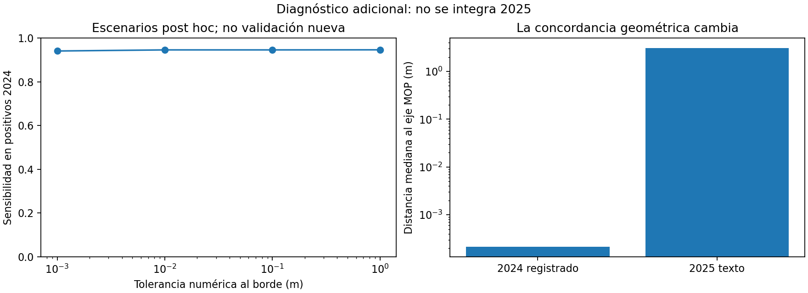

# Cierre de la investigación de ubicación vial 2025

Proyecto: **Predicción dinámica de siniestros en carreteras chilenas**.
Revisión adicional del 14/11/2026, solicitada por Diego tras el
[primer ensayo espacial](validacion_ubicacion_vial.md).

**Decisión para la Entrega III: conservar la base y los resultados 2020–2024.**
Se investigaron redondeo, direcciones, referencias de calle/número, coordenadas y
otras capas oficiales. Se resolvió gran parte del problema numérico de los bordes
de 2024, pero no la identificación y localización comparable de la cohorte 2025.
Se aplica la alternativa autorizada por Diego si la ampliación no queda respaldada.

## Bordes: una parte del problema sí se pudo resolver

Los 433 positivos de 2024 rechazados por borde tienen km registrado múltiplo
exacto de 5. Se probaron escenarios de redondeo **post hoc**, sin cambiar el
protocolo anterior, sus tablas ni auditoría.

| Tolerancia numérica | Positivos de borde recuperados | Positivos asignables totales | Sensibilidad exploratoria | Falsos positivos conocidos |
|---|---:|---:|---:|---:|
| 0,001 m | 419 | 2.452 | 94,13 % | 64 |
| 0,01 m | 432 | 2.465 | 94,63 % | 64 |
| 0,1 m | 432 | 2.465 | 94,63 % | 64 |
| 1 m | 433 | 2.466 | 94,66 % | 66 |

El escenario de 1 m también reclasifica dos eventos de otras vías. Las 512
propuestas sin etiqueta verificable siguen sin resolverse. Corregir una diferencia
numérica alrededor de un límite no acredita pertenencia vial o precisión física.
2024 ya se usó para estudiar errores: esto es diagnóstico y desarrollo, **no una
validación nueva ni una regla seleccionada para producción**.
[Escenarios completos](../resultados/cierre_ubicacion_2025/escenarios_bordes.csv).

## Direcciones: información adicional y sus límites

El EDA inicial seleccionaba 21 campos y no incluía direcciones. Se obtuvo un
complemento de 15 campos de la [fuente oficial](https://services3.arcgis.com/vaJl1B5HEzZj7154/arcgis/rest/services/Base_SINIESTROS_2020_2025/FeatureServer/0),
incluidos Dirección, Calle_Uno, Calle_Dos y Número. Se comprobaron conteos, FID,
lotes, hashes y edición: 216.340 filas de 2023–2025, unos 13,19 MiB comprimidos.
La edición coincide con el EDA anterior; sus originales no se sustituyeron.

Se leyó estrictamente `RUTA 5 SUR <número>, <comuna>`, comprobando comuna y
separando caleteras e intersecciones. La salida se llama **numero_textual**: no se
transforma silenciosamente en km ni rellena los atributos originales.

| Control nacional | 2023 | 2024 |
|---|---:|---:|
| Ruta 5 Sur registrada | 2.863 | 2.605 |
| Con referencia numérica extraíble | 2.863 | 2.605 |
| Otras rutas etiquetadas que cumplen el patrón | 0 | 0 |
| Sin ruta etiquetada que también cumplen el patrón | 2 | 6 |
| Número textual distinto del km registrado | 6 | 2 |
| Tramo distinto al interpretar directamente el número como km | 1 | 0 |

La dirección y los atributos pueden proceder del mismo registro/proceso: la
concordancia no es validación independiente. Los ocho casos sin ruta etiquetada
no se contaron como falsos positivos ni como pertenencia confirmada.

En 2020–2024 hay 33 diferencias entre número textual y km registrado. Incluyen
otra escala (74.500 en una dirección frente a km 74,5) y redondeo (249,95 frente
a km 250,0). No se dividieron o redondearon números de manera universal para
forzar coincidencias. [Control nacional](../resultados/cierre_ubicacion_2025/control_nacional.csv)
y [control histórico](../resultados/cierre_ubicacion_2025/control_historico.csv).

### Referencias encontradas en 2025

| Estado | Registros |
|---|---:|
| Ruta con número y comuna concordante, unidad no acreditada | 2.791 |
| Caletera o vía de servicio | 88 |
| Intersección | 18 |
| Mención sin número interpretable | 2 |
| Comuna discordante | 1 |
| Sin mención literal de Ruta 5 Sur | 66.094 |

En las 2.791 referencias el número coincide con Número: verifica la lectura,
**no aporta otra medición independiente**. Cuatro valores quedan fuera del
dominio del modelo si se interpretan como km: 0, 1.871, 36.800 y 1.275,3.
Eso no demuestra que sean errores: pueden representar otra unidad, numeración
urbana o una localización que extendería el ámbito actual. No se eligió una
interpretación caso a caso para integrarlos.

Fuera de la mención literal hay 35 referencias a PANAMERICANA, 215 a AUTOPISTA
CENTRAL y 51 a RUTA TRAVESIA; son categorías no excluyentes. No todas pertenecen
al ámbito del modelo: PANAMERICANA SUR aparece incluso en comunas de distintas
regiones, incluida Copiapó. Aceptar todos esos nombres sería incorrecto; excluirlos
todos tampoco acredita haber recuperado el universo de Ruta 5 Sur. Falta una
equivalencia validada con la clasificación histórica del campo Ruta.

Por eso **2.791 referencias no equivalen a 2.791 eventos finalmente asignados**.
Los restantes registros no pueden convertirse en ausencia de siniestros para una
grilla de entrenamiento/prueba. No se presentó una cohorte parcial como todo 2025.
[Estados](../resultados/cierre_ubicacion_2025/estados_texto_2025.csv),
[perfil numérico](../resultados/cierre_ubicacion_2025/perfil_referencias_2025.csv) y
[nombres alternativos](../resultados/cierre_ubicacion_2025/alias_sin_mencion_literal_2025.csv).

## Contraste geográfico adicional

Se contrastaron las referencias numéricas con el eje MOP ya conservado, únicamente
como diagnóstico. No se aceptaron números o rutas por ser próximos.

| Contraste | Positivos registrados 2024 | Referencias numéricas 2025 |
|---|---:|---:|
| Referencias examinadas | 2.605 | 2.791 |
| Con M finita dentro de 200 m | 2.580 | 2.755 |
| Distancia mediana al eje | 0,000215 m | 3,073 m |
| Distancia percentil 90 | 0,000469 m | 6,758 m |
| Número/km y medida M difieren más de 100 m | 7 | 212 |

No son etiquetas equivalentes: en 2024 se conoce el km registrado; en 2025 se
examina un número de dirección de unidad no acreditada. Las 212 diferencias no
se declaran errores. El cambio impide trasladar directamente al año nuevo la
concordancia casi exacta de 2024. La dependencia y el método de geocodificación
siguen sin acreditarse; precisión decimal no demuestra exactitud física.



[Comparación geográfica](../resultados/cierre_ubicacion_2025/comparacion_geografica.csv).

## Otras capas oficiales examinadas

Se consultaron esquemas y rangos de años, sin asumir frescura por el nombre:

| Servicio CONASET | Comprobado | Límite para resolver este caso |
|---|---|---|
| siniestros_2 | 2020–2024, con ruta y ubicación | No aporta los atributos faltantes de 2025 |
| siniestros2020_2024 | 2020–2024, con ruta y ubicación | Mismo límite temporal |
| puntos_siniestros | 2019–2023 | No es una actualización de Ruta 5 Sur 2025 |
| tramos_con_siniestro | ROL y agregados por tramo, sin año/evento para este cruce | No recupera la ubicación de un evento individual |
| redvialdisol | Geometría y ROL | No es etiqueta independiente del evento |
| Reporte_mensual_siniestros | 2020–2026, fecha/hora y comuna; sin ruta/km o coordenadas | SECTOR tiene RURAL/URBANA en 2025; no identifica carretera |

[Enlaces y campos](../resultados/cierre_ubicacion_2025/fuentes_adicionales.csv).
No se afirma que no exista otra fuente: no se obtuvo una que acredite las etiquetas
necesarias para la cohorte completa. El servicio preferido MOP volvió a agotar el
tiempo. El ZIP anuncia unos 214 MB y no respetó la solicitud parcial: no se repitió
su descarga nacional completa, que tampoco aportaría las etiquetas de los eventos.

## Alcance final y condiciones para reabrir

Para esta entrega se cierra la ampliación y se conserva **2020–2024, 14.420
siniestros y 255 tramos**, con sus fuentes, cuarentena, particiones, selección,
modelos y evaluación histórica. UTC/DST y los límites del proxy vehicular se
mantienen. 2025 queda como investigación documentada, fuera de las cifras finales.

Faltan semántica, clasificación vial comparable y verificación de ubicaciones;
corregir el redondeo no resuelve esos puntos. No se imputaron atributos definitivos,
unidades o falsos ceros ni se reentrenó para obtener una mejora aparente.

Para reabrir hacen falta microdatos 2025 con ruta/km acreditados o información
verificable del proveedor sobre normalización de vías, unidad de Número y
geocodificación, más controles de la recuperación completa. No se enviaron
solicitudes a instituciones. El mantenimiento periódico no debe repetir este
intento sin insumos nuevos que resuelvan esos límites.

## Reproducción

Con el entorno del proyecto, el complemento `requirements-espacial.txt` y los
originales locales de esta revisión y del ensayo anterior:

```bash
OMP_NUM_THREADS=2 OPENBLAS_NUM_THREADS=2 MPLCONFIGDIR=/tmp/siniestros-matplotlib .venv/bin/python proyecto.py examinar_ambiguedades --fuente data/fuentes/conaset/direcciones_20261114
```

La [auditoría](../resultados/cierre_ubicacion_2025/auditoria.json) contiene consulta,
hashes de originales/código/derivados y decisión. Los derivados de investigación
están en `data/fuentes/conaset/diagnostico_textual_20261114/`, fuera de Git; no
incluyen ruta/km aprobados para entrenar. No se publican direcciones individuales.

Para crear otro complemento sin sobrescribir originales (la fuente puede cambiar):

```bash
.venv/bin/python proyecto.py descargar_direcciones_conaset --salida data/fuentes/conaset/direcciones_nuevas
```

Para consultar solo los metadatos adicionales, sin descargar sus eventos:

```bash
.venv/bin/python proyecto.py descargar_direcciones_conaset --solo-catalogo --salida data/fuentes/conaset/catalogo_nuevo
```

Después se puede indicar esa carpeta mediante `examinar_ambiguedades --catalogo`.
La revisión adicional de metadatos está en
`data/fuentes/conaset/fuentes_adicionales_20261114/`. Se consultan los esquemas en
`.../<servicio>/FeatureServer/0?f=json`, mínimo/máximo del campo Año con
`outStatistics` en `/query` y los distintos de SECTOR para `Año=2025` del reporte
mensual. Los enlaces están en el inventario versionado. Siete pruebas nuevas
comprueban texto, unidades no inferidas, intersecciones, comunas, redondeo,
denominadores de desconocidos y descarga incompleta.
