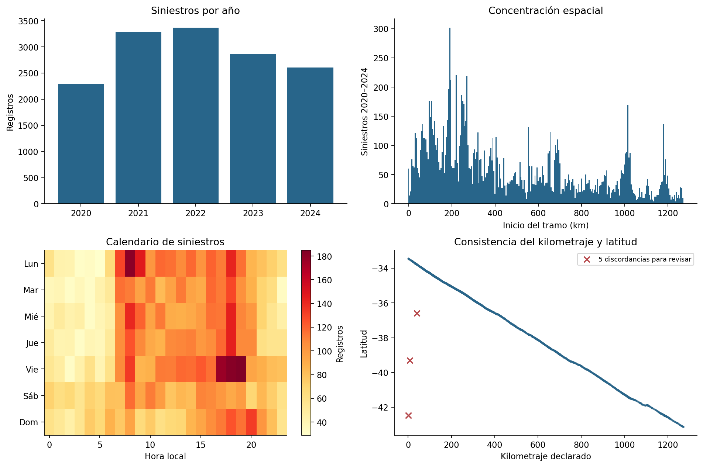
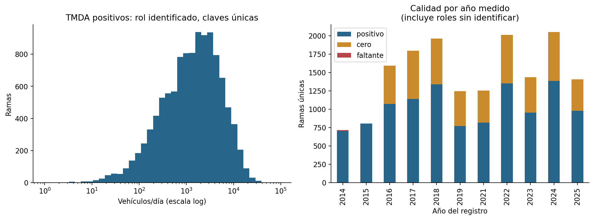
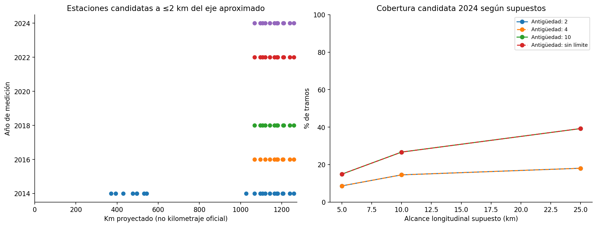
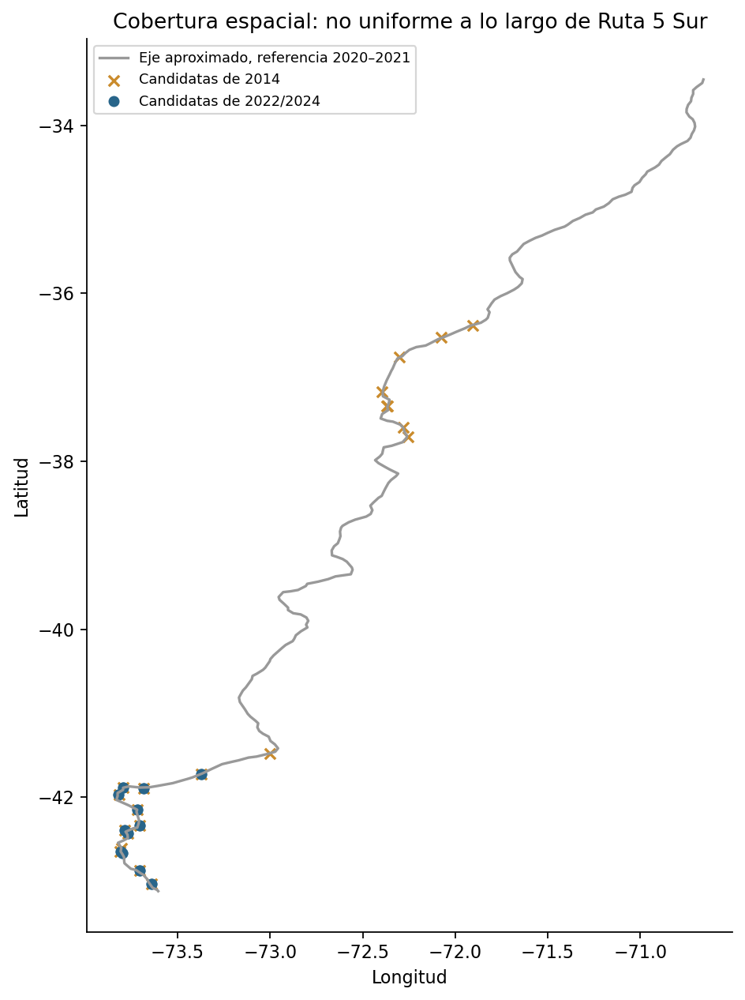
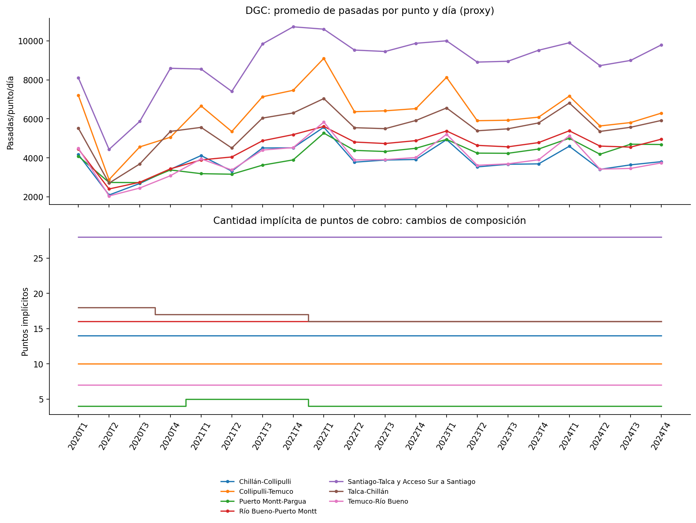
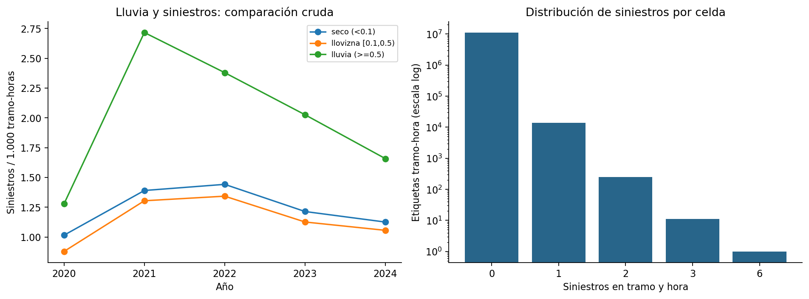

# Análisis exploratorio y decisiones de datos

<!-- INICIO_EDA_ENTREGA3 -->
### Bitácora del EDA previo al entrenamiento

**Fase exploratoria: 12 de noviembre de 2026.** Esta sección conserva el diagnóstico
y las decisiones al cerrar el EDA, antes de la comparación posterior de modelos.
Las corridas anteriores se conservan como comprobación de las correcciones de código.
No se entrenaron modelos durante este EDA; su código tampoco ejecuta el entrenamiento.

El análisis se reproduce sin red con:

```bash
.venv/bin/python proyecto.py explorar_datos --actualizar-readme
```

Requiere las fuentes ya descargadas. Su código está en [explorar_datos.py](../codigo/evaluacion/explorar_datos.py)
y las tablas y figuras en [resultados/eda](../resultados/eda). Se lee cada versión original,
se registran hashes y no se modifican las fuentes ni las salidas de los modelos.

#### 1. Siniestros: población y calidad

- Ruta 5 Sur: 14.430 registros; se conservan 14.425 tras excluir cinco con km inválido.
  El filtro `km > 0` conserva la decisión anterior de tratar cero como ubicación desconocida;
  no demuestra que todo cero de kilometraje sea físicamente imposible.
- 0 IDs duplicados, 0 faltantes en campos críticos,
  0 discrepancias entre lesionados totales y su desglose, y
  0 registros con severidad negativa. Campos completos no prueban
  exhaustividad del registro ni ausencia de subregistro.
- La hora está redondeada: 93,9 % de minutos son múltiplos de cinco;
  82,4 % de kilómetros son enteros. Se mantiene resolución horaria y de 5 km.
- 6,8 % de eventos se etiquetan urbanos. El 10,2 %
  de tramos con más eventos concentra 29,0 % del total
  (26 tramos de 255). No se eliminan eventos graves ni tramos extremos por ser infrecuentes.
- **Se detectan 5 discordancias importantes entre kilómetro y coordenadas.**
  Se obtienen las mismas cinco banderas con umbrales de 5, 10 y 25 km respecto del punto
  histórico del tramo; la distancia máxima es 1.037 km.
  Una correlación global alta no detectaba este problema. Las filas están identificadas
  en [siniestros_discordancia_km_coordenadas.csv](../resultados/eda/siniestros_discordancia_km_coordenadas.csv).
  No se cambian kilómetros, rutas ni coordenadas por suposición y no se borran del conjunto
  principal durante este EDA: requieren revisar el registro de origen antes de reentrenar.
- La referencia espacial usa exclusivamente 2020–2021; es una aproximación de medianas e
  interpolaciones, no un eje vial oficial. Se usa para explorar cobertura, no para certificar
  la pertenencia de una estación a una rama concreta.



#### 2. PNCV del MOP: año medido, ceros y duplicaciones

- Se obtuvieron 18.289 filas con texto no vacío en rol a partir de seis capas
  (incluye marcadores y códigos sin identificar, no solo rutas identificadas).
  Son 16.265 claves distintas estación–rama–año–rol; las versiones
  no se suman como mediciones independientes.
- Hay 5.603 TMDA iguales a cero y 16 faltantes
  en las filas originales con rol. Cero se conserva como **valor sin interpretar**, no se
  equipara automáticamente a ausencia de circulación ni se reemplaza por un flujo positivo.
- De esos ceros, 5.538 tienen rol marcador, principalmente `-`:
  no se deben tratar como mediciones de carreteras identificadas sin tráfico. Se cruzan
  estado de rol y TMDA antes de describir la distribución. Ruta 5 tiene
  3 faltantes en sus claves únicas.
- Se detectan 2.016 claves repetidas entre capas,
  0 con TMDA contradictorio en esas claves.
  Los resúmenes de distribución usan claves únicas; se conserva la procedencia original.
- 0 coordenadas fuera del rango de comprobación y
  704 ramas con TMDA positivo pero rol vacío.
  Estar dentro del rango de Chile no valida la posición exacta en la carretera.
- **No hay registros con año de medición 2020 en esta descarga.** La capa titulada
  `2020 Sur - 2021 Norte` contiene 2021 y 2022; no se cambian esos registros a 2020.
  El problema está en la correspondencia título/contenido de la fuente y queda documentado.

| Capa | Título publicado | Años en los registros | Filas fuera de años del título |
|---|---|---|---:|
| 0 | 2024 Sur - 2025 Norte | 2024,2025 | 0 |
| 1 | 2022 Sur - 2023 Norte | 2022,2023 | 0 |
| 2 | 2020 Sur - 2021 Norte | 2021,2022 | 2.016 |
| 3 | 2018 Sur - 2019 Norte | 2018,2019 | 0 |
| 4 | 2016 Sur - 2017 Norte | 2016,2017 | 0 |
| 5 | 2014 Sur - 2015 Norte | 2014,2015 | 0 |

TMDA tiene asimetría y extremos: se inspeccionan positivos en escala logarítmica y se
guardan los 20 mayores para revisión. Un extremo no se elimina sin evidencia de error.



#### 3. Cobertura espacial y antigüedad: no basta con encontrar una estación cercana

La exploración mantiene solo estaciones a un máximo de 2 km del eje aproximado y prueba
alcances longitudinales de 5, 10 y 25 km, con antigüedades máximas de 2, 4 y 10 años y
sin límite. Son supuestos de sensibilidad, no radios acreditados de representatividad.
La geometría de referencia es la misma para todas las comparaciones.

Ejemplo para 2024, con alcance longitudinal supuesto de 10 km:

| Antigüedad máxima (años) | Tramos candidatos | % de tramos | % de siniestros de 2024 en ellos |
|---|---:|---:|---:|
| 2 | 37/255 | 14,5 % | 6,4 % |
| 4 | 37/255 | 14,5 % | 6,4 % |
| 10 | 68/255 | 26,7 % | 18,7 % |
| sin_limite | 68/255 | 26,7 % | 18,7 % |

Las estaciones recientes cercanas se concentran en la parte sur del corredor; parte de
la cobertura aparente del resto proviene de mediciones antiguas. Los resultados no se
deben extrapolar a todos los tramos ni a la hora punta. Año de medición anterior al evento
no acredita que el dato estuviera publicado antes de predecir. Las fechas de disponibilidad
siguen sin acreditarse en las 18.289 filas de ramas.




#### 4. Concesiones: versiones, períodos y unidades

- Los anexos 2023T4 y 2024T4 aportan 252 filas de siete contratos del
  sur. Se solapan en 112 contrato-trimestres; sumarlos duplicaría esos períodos.
- En el solapamiento se detectaron 0 revisiones de transacciones
  y 0 revisiones de promedios por punto. Que estas dos versiones coincidan no
  acredita disponibilidad histórica ni descarta revisiones en otras versiones.
- Para descripción se conserva la versión más reciente por contrato y trimestre:
  140 observaciones (7 contratos × 20 trimestres, 2020–2024),
  0 períodos faltantes. La versión usada queda en cada fila.
- Se distinguen **pasadas trimestrales** y **promedio mensual por punto de cobro**.
  `promedio mensual × 3 / días del trimestre` es un proxy diario por punto, no TMDA
  por tramo ni número de vehículos únicos. No se suman los promedios de siete contratos
  para inventar un tránsito medio de toda la ruta.
- `pasadas trimestrales / (3 × promedio mensual por punto)` permite revisar la cantidad
  implícita de puntos. Cambia en dos contratos; puede alterar las comparaciones de totales:

- Puerto Montt-Pargua: 2021T1, 5 puntos implícitos (cambia respecto al trimestre anterior).
- Puerto Montt-Pargua: 2022T1, 4 puntos implícitos (cambia respecto al trimestre anterior).
- Talca-Chillán: 2020T4, 17 puntos implícitos (cambia respecto al trimestre anterior).
- Talca-Chillán: 2022T1, 16 puntos implícitos (cambia respecto al trimestre anterior).

Estas cantidades son inferidas algebraicamente de los anexos, no una verificación física
de apertura/cierre de plazas. Los crecimientos interanuales se entregan junto con los
cambios de puntos para no atribuirlos automáticamente a circulación.

Santiago–Talca incluye Acceso Sur. Los contratos del sur disponibles no equivalen por sí
solos al universo de 255 tramos, que también incluye Chiloé. No se correlacionaron conteos
por tramo con flujo por contrato sin una correspondencia vial comprobada.



#### 5. Clima nuevo y variable de conteo

- ERA5 explícito: 59 celdas para 255 tramos; 43.848
  etiquetas horarias de 2020–2024. Se comprobaron alineación temporal y exposición DST.
- Hay 5 etiquetas de hora inexistente y
  5 repetidas. Los 295 NaN
  estructurales de ERA5 corresponden a las horas inexistentes en sus celdas;
  0 faltantes en horas que sí existen y
  0 siniestros registrados en horas inexistentes.
- 81,0 % de las etiquetas tramo-hora existentes tienen
  0 mm; máximo 11,2 mm/h. Se conservan los extremos.
- Los umbrales implementados con `np.digitize` son exactamente: seco `<0,1`, llovizna
  `0,1 ≤ p < 0,5`, lluvia `p ≥ 0,5` mm/h. El texto anterior `>0,5` no describía
  exactamente la frontera del código; la categoría de 0,5 se aclara sin cambiar el corte.
- 99,87 % de celdas sin siniestros. Los ceros abundantes
  no bastan para elegir una familia probabilística. El perfil crudo por lluvia se entrega
  sin ajuste espacial, de calendario o de flujo y no prueba un efecto causal.
- El reanálisis describe condiciones históricas; no certifica una predicción con el
  pronóstico que habría estado disponible 12 horas antes. Varios tramos comparten celda
  ERA5: repetirla no agrega observaciones meteorológicas independientes.
- Calendario: 243 fechas marcadas en la fuente, 242
  dentro de 2020–2024. Se describen días y siniestros por posición en feriado, incluyendo
  días sin eventos. La primera fecha marcada es 2019-12-31 y la última
  2024-12-25; esos extremos no prueban exhaustividad de los feriados legales.
  No se extrapola el calendario a 2026.



#### Decisiones y pendientes registrados al cerrar el EDA

1. Mantener PNCV y DGC separados: unidad estación/rama/año versus contrato/trimestre.
2. Revisar los cinco siniestros con discordancia espacial y resolver su tratamiento;
   los filtros originales de kilometraje no bastaban para comprobar ubicación.
3. Resolver el año faltante 2020 y documentar antigüedad/fechas de publicación antes de
   proponer exposición histórica. No renombrar mediciones para completar una serie.
4. Construir o conseguir una correspondencia documentada estación/rama o contrato →
   tramo. La cercanía y los límites de una concesión no prueban un flujo homogéneo.
5. Aclarar los ceros de TMDA y los cambios de puntos de cobro; mantener faltantes como tales.
6. Mantener vacía la tabla de exposición validada mientras estas cuestiones sigan abiertas.
   No se ha estimado todavía riesgo por vehículo-km ni se declara validado un modelo final.
7. Después, retomar el protocolo temporal, comparación GB/RF e interpretación. El EDA
   inspecciona también 2024, por lo que ese año no se debe presentar como una prueba intacta.

#### Registro de avances y cambios

| Fase | Avance | Estado al cerrar el EDA |
|---|---|---|
| Revisión inicial | Cruce de propuesta, presentación, rúbrica y retroalimentación; plan de Entrega 3 | Documentado |
| Correcciones de código | Captura con empates/presupuesto, convergencia, limpieza común, referencia desde pasado, UTC/DST y calendario | Implementadas y comprobadas |
| Comprobación técnica anterior | Corridas M0/M1/M2/M3, train/prueba, bootstrap de lluvia, turnos y recalibración con año previo | Diagnóstico previo; no selección final |
| Descarga y preparación | Seis capas PNCV, dos anexos DGC y ERA5; procedencia y versiones preservadas | Completadas |
| EDA actual | Calidad, duplicaciones, años, antigüedad, cobertura, unidades, cambios de composición y clima | Ejecutado; limitaciones abiertas descritas arriba |
| Exposición vehicular | Correspondencia por tramo, representatividad y disponibilidad histórica | Pendiente de resolver |
| Comparación y elección de modelos | GB/RF y evaluación final según el plan | En espera del análisis de datos |
| Comunicación | Notebook y presentación | Para el final, por indicación del equipo |

El EDA no modificó el notebook, la presentación, las fuentes descargadas ni los artefactos
de ajuste. Los resultados anteriores se conservan sin convertirlos en evidencia nueva.
<!-- FIN_EDA_ENTREGA3 -->
