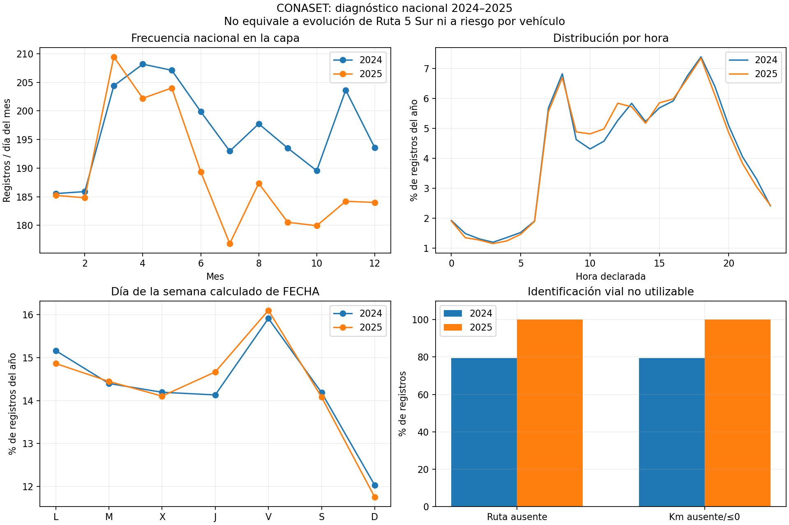

# EDA y admisibilidad de CONASET 2025

Proyecto: **Predicción dinámica de siniestros en carreteras chilenas**.
Revisión del 14/11/2026, previa a cualquier incorporación al modelo.

**Decisión actual:** la instantánea oficial permite un EDA nacional, pero **no se
admite todavía para entrenar ni evaluar Ruta 5 Sur por tramo/hora**. En 2025 faltan
la ruta y el kilómetro en todos los registros. La procedencia oficial y la
consistencia de campos no acreditan la ubicación vial ni la cobertura completa.
El experimento 2020–2024, sus modelos y su cuarentena permanecen vigentes.

## Fuentes examinadas y alcance de la descarga

El punto de entrada fue el [Observatorio que compartió Diego](https://www.conaset.cl/programa/observatorio-datos-estadistica/index.html).
Su contenido oficial indexado presenta tres vías: Biblioteca, Estadísticas e
Información Geoespacial. Se revisaron también los índices de
[estadísticas generales](https://www.conaset.cl/programa/observatorio-datos-estadistica/biblioteca-observatorio/estadisticas-generales/),
[estadísticas regionales](https://conaset.cl/programa/observatorio-datos-estadistica/biblioteca-observatorio/estadisticas-regionales/index.html),
[informes comunales 2025](https://www.conaset.cl/programa/observatorio-datos-estadistica/biblioteca-observatorio/estadisticas-comunales/informes-comunales-2025/index.html)
y [estudios](https://conaset.cl/programa/observatorio-datos-estadistica/biblioteca-observatorio/estudios/index.html).

| Material | Cómo puede ayudar | Límite para nuestro modelo |
|---|---|---|
| Estadísticas generales: series, meses, días, horas, zonas y regiones hasta 2025 | Contrastar márgenes y contextualizar tendencias | Las tablas agregadas no reconstruyen eventos por tramo/hora |
| Informe nacional e informes regionales/comunales | Contrastar totales y describir el contexto territorial | Una comuna incluye otras vías; su total no es el total de Ruta 5 Sur |
| Geocodificación de siniestros | EDA de microdatos y potencial evaluación temporal adicional | Hace falta acreditar pertenencia vial y kilometraje |
| Estudios de comportamiento y opinión | Contextualizar seguridad vial y limitaciones | Una encuesta no aporta exposición horaria por tramo |
| Reporte diario de fallecidos | Contexto reciente de mortalidad | No observa todos los siniestros ni sus tramos/horas |

La lectura directa del HTML volvió a fallar por acceso/certificado y el navegador
de esta sesión no estuvo disponible. No se desactivó TLS. Los índices y cifras
nacionales se contrastaron en contenido oficial indexado; **no se descargaron ni
auditaron los Excel/PDF enlazados ni el informe nacional completo**. El EDA que
sigue sí usa respuestas directas de la
[capa REST oficial Base_SINIESTROS_2020_2025](https://services3.arcgis.com/vaJl1B5HEzZj7154/arcgis/rest/services/Base_SINIESTROS_2020_2025/FeatureServer/0).
No debe confundirse la revisión del catálogo con un análisis de cada archivo.

Se descargaron los años nacionales 2024 y 2025, seleccionando 21 campos de
identificación, calendario, territorio, ruta, kilómetro, consecuencias y coordenadas.
Se excluyeron direcciones y causas, innecesarias para este diagnóstico.
No se descargó nuevamente toda la serie 2020–2025.

## Integridad de la instantánea

Se verificaron el conteo y la lista completa de FID de cada año; se consultaron
lotes de 500 identificadores, conservando y comprobando cada respuesta. Los lotes
se rechazan si faltan FID, se repiten, aparecen otros o se informa truncamiento.
Las listas iniciales/finales y los metadatos de edición/esquema coincidieron.
La lectura para el EDA volvió a comprobar hashes, años, unicidad y completitud.
Esto acredita la descarga del universo que entrega **esa capa**, no su equivalencia
con todos los siniestros nacionales ni la exactitud de cada evento.

Los originales comprimidos y el manifiesto están en
`data/fuentes/conaset/eda_2025_20261114_completa/`, excluidos de Git, unos 6,52 MiB.
La [auditoría publicada](../resultados/eda_2025/auditoria.json) registra procedencia,
consulta, versiones del entorno, revisión del servicio y hashes de originales,
histórico y scripts. Se publican agregados, no las filas crudas de eventos.

## Cobertura y calidad observada

| Comprobación | 2024 | 2025 |
|---|---:|---:|
| Registros en la capa | 72.043 | 68.994 |
| Días con eventos / días del año | 366 / 366 | 365 / 365 |
| Ruta ausente, incluidos espacios | 57.161 (79,34 %) | 68.994 (100 %) |
| Kilómetro ausente, cero o negativo | 57.242 (79,46 %) | 68.994 (100 %) |
| Eventos etiquetados RUTA 5 SUR | 2.605 | 0 |
| Coordenadas nulas, no finitas, cero o fuera de rango angular | 0 | 0 |
| Fuera del recuadro continental auxiliar | 41 | 73 |
| Coordenadas exactas distintas | 46.817 | 42.694 |
| Filas en coordenadas repetidas | 36.334 | 38.575 |
| Filas iguales en los campos descargados, salvo FID/ID | 617 | 637 |

No se encontraron FID o ID repetidos dentro de un año, fechas/horas inválidas,
discrepancias de año, mes o día de la semana, discrepancias entre hora declarada y
Hora_aprox, consecuencias negativas ni sumas de lesiones inconsistentes.
No hay ID compartidos entre 2024 y 2025 en esta instantánea. Estas verificaciones
no prueban que cada ID represente un suceso físico diferente.

La fuente usa horas como `8:15:00` y `18:15:00`; ambas son válidas. No se exige un
cero inicial ni se convierte el primer formato en faltante. FECHA se almacena
como medianoche con referencia UTC en ArcGIS: se conserva su etiqueta de calendario
y se revisa Hora por separado. **No se interpreta esa medianoche como la hora del
siniestro ni se desplaza la fecha automáticamente a Santiago.** Sigue pendiente
acreditar la semántica horaria y resolver UTC/DST antes de una integración.

Los 41/73 puntos fuera del recuadro [-56,-17] × [-76,-66] están etiquetados como
**Isla de Pascua**. El recuadro no cubre todo Chile: no se eliminaron estos puntos.
No se realizó una validación punto-en-polígono por comuna ni una comprobación
contra el eje vial. Una coordenada angular válida puede estar mal geocodificada.

Las 637 filas parecidas de 2025 son una **señal para revisar**, no duplicados
demostrados. Faltan campos en esta descarga y varios eventos reales pueden compartir
ubicación y hora aproximadas. No se descartó ninguna fila por esta razón.
En 2025, el 38,24 % de las horas declara minuto 00 o 30, lo que aconseja no atribuir
precisión al minuto sin documentación adicional.

El [contraste con el histórico de Ruta 5 Sur 2024](../resultados/eda_2025/contraste_historico_2024.csv)
recuperó los mismos 2.605 ID, sin faltantes ni eventos extra y sin diferencias en
los 19 campos comparados después de representar FECHA de forma equivalente.
Se excluyeron FID, identificador interno del servicio, e ID, usado para cruzar.
No se compararon campos no descargados. Esto apoya la continuidad del control de
2024, pero no recupera las etiquetas ausentes de 2025.

## Conciliación con cifras publicadas

El [balance oficial 2024](https://www.conaset.cl/balance-de-siniestralidad-vial-2024-confirma-historica-reduccion-de-muertes-y-lesionados/)
publicado el 05/05/2025 informa 75.653 siniestros y 1.439 fallecidos.
El [Observatorio](https://www.conaset.cl/programa/observatorio-datos-estadistica/index.html)
informa 73.081 siniestros y 1.507 fallecidos en 2025. Son referencias publicadas
que pueden tener fechas de revisión distintas a la capa consultada.

| Año | Siniestros publicados | En capa | Diferencia | Cociente capa/publicado | Fallecidos publicados / en capa |
|---|---:|---:|---:|---:|---:|
| 2024 | 75.653 | 72.043 | 3.610 | 95,23 % | 1.439 / 1.307 |
| 2025 | 73.081 | 68.994 | 4.087 | 94,41 % | 1.507 / 1.407 |

Estos cocientes **no son una probabilidad de captura validada**. Falta conciliar
universos, geocodificación y revisiones; no se comprobó la causa de la diferencia.
No se aplica una corrección proporcional a Ruta 5 Sur. La mezcla urbana/rural y
la cobertura territorial pueden diferir y afectar la interpretación del conteo.

## Exploración temporal y territorial



En la capa de 2025 hay eventos todos los días y meses. Marzo tiene el mayor
promedio mensual, 209,45 registros/día; julio el menor, 176,81. Por hora declarada,
18:00–18:59 reúne 5.063 registros (7,34 %) y 08:00–08:59, 4.614 (6,69 %).
Las distribuciones horarias de ambos años son parecidas visualmente; no se efectuó
una prueba de equivalencia ni se atribuye el patrón al flujo.

La proporción etiquetada como rural pasa de 22,20 % a 24,93 %. Esto describe
**composición de la capa**, no una variación del riesgo por conductor. Las tablas
de región, zona y tipo permiten revisar cambios; no identifican su causa. El
viernes concentra el mayor número de registros de 2025, pero las proporciones por
día de la semana tampoco ajustan por cuántos días de cada tipo hubo ni por tránsito.
Los promedios mensuales sí consideran los días del mes y el año bisiesto de 2024.

Resultados: [resumen](../resultados/eda_2025/resumen.csv),
[controles](../resultados/eda_2025/calidad.csv),
[perfil por campo](../resultados/eda_2025/campos.csv),
[repeticiones](../resultados/eda_2025/repeticiones.csv),
[meses](../resultados/eda_2025/mensuales.csv),
[horas](../resultados/eda_2025/hora.csv),
[minutos](../resultados/eda_2025/minuto.csv),
[regiones](../resultados/eda_2025/region.csv) y
[puntos fuera del recuadro](../resultados/eda_2025/fuera_recuadro.csv).

## Condiciones para avanzar al modelo y al piloto

La investigación posterior identificó fuentes MOP con medidas de recorrido. La
[validación espacial ejecutada](validacion_ubicacion_vial.md) no superó las
condiciones de incorporación y mantiene la decisión de admisibilidad de este EDA.

1. Recuperar ruta y kilómetro de 2025 de una fuente acreditada, o validar una
   asignación espacial con eje y referencias kilométricas oficiales. La polilínea
   CONASET ya identificada no aporta kilómetros. No asignar automáticamente todo
   punto cercano: hay otras vías, calles paralelas, enlaces y baipases.
2. Si se ensaya una asignación, fijar reglas antes de mirar el desempeño de modelos;
   comprobar pertenencia vial y tramo correcto con positivos y negativos **con
   etiqueta conocida**, manteniendo los casos sin etiqueta como desconocidos.
   Informar errores, ambiguos, exclusiones y sensibilidad a distancia. No se
   ejecutó esa asignación en este EDA ni se adoptó un umbral como validado.
3. Conciliar cobertura y resolver hora local/UTC/DST. Documentar el universo 2025
   resultante y cualquier diferencia respecto del histórico, sin alterar su cuarentena.
4. Comprobar calendario, meteorología y flujo de 2025 con disponibilidad temporal
   adecuada. Este EDA no verificó ni descargó esos insumos nuevos. El proxy DGC
   sigue siendo trimestral: no equivale a exposición por vehículo-km.
5. Congelar la candidata y el protocolo previos antes de obtener métricas de 2025.
   Hacer una evaluación temporal adicional, indicando que ya se exploraron estos
   datos. Si después se reajusta con 2020–2025, evaluar generalización en otro
   período; el propio 2025 deja de ser prueba de ese reajuste.
6. Para el piloto de las siguientes 12 horas, construir las variables disponibles
   en el instante de emisión: calendario vigente y pronóstico meteorológico
   emitido, con trazabilidad. Validar las predicciones contra siniestros observados
   por tramo/hora cuando estén disponibles. CONASET 2025 ayuda a estudiar una
   actualización; no demuestra por sí solo desempeño operativo en 2026.

Estas condiciones son decisiones de calidad propuestas para el proyecto, no nuevas
exigencias atribuidas al profesor. No se enviaron solicitudes a instituciones.

## Reproducción

Con el entorno del proyecto, descargar una instantánea **nueva**, sin sobrescribir
la anterior. La descarga requiere red y unos minutos; no es necesaria para volver
a generar el EDA desde los originales locales:

```bash
.venv/bin/python proyecto.py descargar_revision_conaset --salida data/fuentes/conaset/eda_2025_nueva
MPLCONFIGDIR=/tmp/siniestros-matplotlib .venv/bin/python proyecto.py explorar_conaset_2025 --fuente data/fuentes/conaset/eda_2025_nueva --salida resultados/eda_2025_nueva
```

Para reproducir esta revisión, usar como `--fuente`
`data/fuentes/conaset/eda_2025_20261114_completa` y como salida `resultados/eda_2025`.
Una descarga futura puede diferir: cotejar su manifiesto y conservar la fecha de
consulta. Los agregados publicados permiten revisar las conclusiones sin descargar
los microdatos; para reproducir exactamente su cálculo hacen falta los originales.

Se añadieron seis pruebas de controles de descarga, lectura, hora, ubicación,
repeticiones y contraste histórico. El EDA se generó con Python 3.13.3; las versiones
concretas y hashes están en la auditoría. No se reentrenó ni recalibró ningún modelo.
