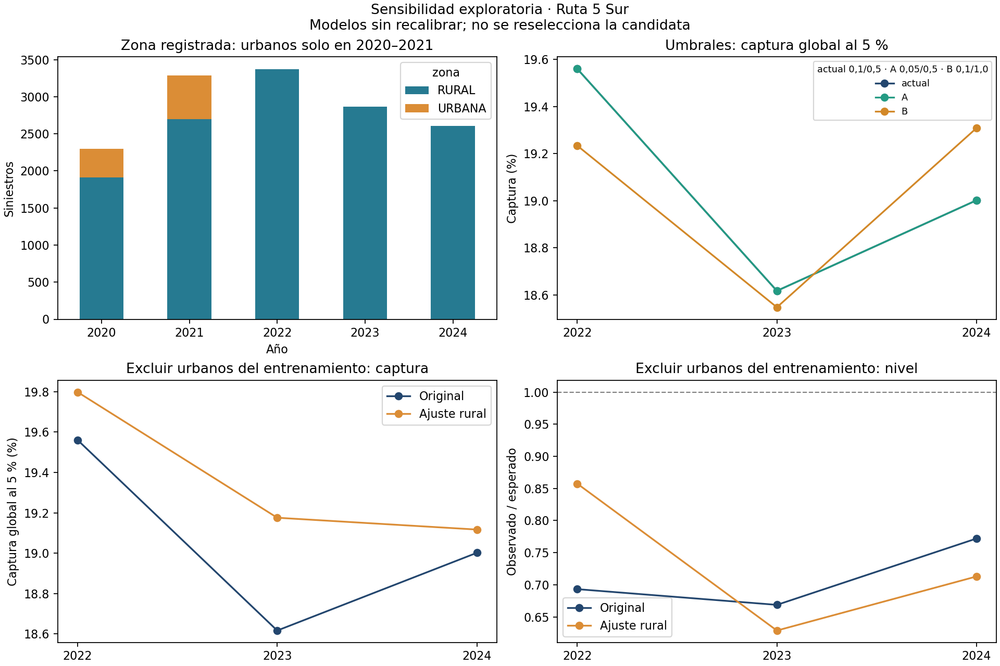

# Sensibilidad urbana, umbrales de lluvia y revisión del piloto

Proyecto: **Predicción dinámica de siniestros en carreteras chilenas**.
Ejecución autorizada por Diego el 14/11/2026, antes del cierre de la ficha de Martín.
Base: `67830c1`. Resultados exploratorios; la candidata y el piloto conservan su
especificación original. No se buscaron hiperparámetros ni se eligió un escenario
con 2024, que sigue siendo evaluación histórica reutilizada.

## Protocolo y controles

Se fijó el [protocolo inicial](../config/protocolo_sensibilidad.md) antes de ejecutar
los escenarios actual (0,1; 0,5), A (0,05; 0,5) y B (0,1; 1,0) mm/h. Se reutilizaron
ERA5, calendario, cuarentena y dominio originales. Los modelos Poisson originales
se cargaron por año; M1 se reconstruyó con su fórmula y penalización originales.
Las nueve métricas publicadas de ambos coinciden para 2022, 2023 y 2024
(rtol=1e−8, atol=1e−10). No se alteraron los archivos científicos de origen.

Las alternativas A y B se ajustaron en cada partición expansiva (seis ajustes),
con L2 original 3 para 2022/2023 y 0,3 para 2024. Los cortes se aplicaron tanto a
entrenamiento como a prueba. No se reutilizaron coeficientes con categorías nuevas.
Los hashes y diagnósticos de convergencia están en
[la auditoría](../resultados/sensibilidad/auditoria.json).

## 1. Sensibilidad urbana: hallazgo de calidad de etiquetas

El total limpio tiene 13.445 eventos RURAL y 975 URBANA (6,76 %), sin etiquetas
faltantes o desconocidas. Pero la distribución temporal es decisiva:

| Año | RURAL | URBANA |
|---|---:|---:|
| 2020 | 1913 | 382 |
| 2021 | 2695 | 593 |
| 2022 | 3369 | 0 |
| 2023 | 2863 | 0 |
| 2024 | 2605 | 0 |

Los 975 eventos urbanos pertenecen al entrenamiento inicial 2020–2021. En los años
de prueba 2022–2024 todos están etiquetados RURAL. Esto describe el campo de la
fuente; **no demuestra que la carretera dejara de atravesar zonas urbanas**.
No se ha acreditado la causa de esa discontinuidad. Tampoco se usó la etiqueta
«Rutas» del campo Zonas_urb_ como sustituto de ZONA.

El diagnóstico con ranking congelado conserva los 255 tramos y el presupuesto
sobre todos los tramos-hora. La captura rural coincide necesariamente con la total;
la urbana queda vacía por ausencia de eventos y no se informa como cero.
Los IC semanales pareados rural/total son duplicados del mismo universo, no dos
validaciones independientes. No es posible medir desempeño urbano en prueba con
estas etiquetas. Véanse [población](../resultados/sensibilidad/poblacion_zona.csv),
[captura](../resultados/sensibilidad/urbana.csv) e
[intervalos](../resultados/sensibilidad/urbana_ic.csv).

## 2. Exclusión urbana del entrenamiento

Ante el hallazgo se fijó un [segundo protocolo](../config/protocolo_sensibilidad_urbana_ajuste.md)
antes de ajustar los modelos. Se excluyeron los 975 eventos URBANA del entrenamiento;
se mantuvieron los tramos, la referencia espacial original, exposición, lluvia,
particiones y penalizaciones. Se ajustaron Poisson y M1 a conteos etiquetados RURAL.
Es un objetivo exploratorio distinto; no es un mapa de tramos rurales ni excluye
tramos enteros. La prueba rural y la original coinciden exactamente por la
composición de las etiquetas, condición comprobada por código.

| Prueba | Eventos train original → rural | Captura Poisson original → rural | O/E original → rural | MAE total/turno original → rural |
|---|---|---|---|---|
| 2022 | 5583 → 4608 | 19.56 % → 19.80 % | 0.693 → 0.857 | 2.922 → 2.284 |
| 2023 | 8952 → 7977 | 18.62 % → 19.18 % | 0.669 → 0.629 | 2.536 → 2.783 |
| 2024 | 11815 → 10840 | 19.00 % → 19.12 % | 0.772 → 0.713 | 1.970 → 2.178 |

La captura global de Poisson cambia poco (entre +0,12 y +0,56 puntos), pero el
nivel de conteos es más sensible: el MAE mejora en 2022 y empeora en 2023/2024.
Por tanto, la exclusión no produce una mejora uniforme. Cambia la distribución
temporal de entrenamiento y puede afectar la tendencia; no se atribuye
causalmente el efecto a la urbanización. No se calculan IC para este reajuste.

El M1 rural también se reconstruyó como comparador con la misma población;
sus cifras completas están en [métricas del ajuste rural](../resultados/sensibilidad/ajuste_rural/metricas.csv).
La [auditoría](../resultados/sensibilidad/ajuste_rural/auditoria.json) conserva
parámetros, tamaños de entrenamiento, convergencia y hashes. Este análisis cumple
la exclusión de eventos urbanos, pero no acredita robustez frente a zonas físicas
urbanas; esa pregunta necesita etiquetas comparables y casos urbanos en prueba.

## 3. Sensibilidad de los cortes de lluvia

Todos los modelos de esta tabla son Poisson sin recalibrar y usan la ruta completa.

| Prueba | Escenario | Captura global 5 % | Captura por turno 5 % | O/E | MAE total/turno |
|---|---|---:|---:|---:|---:|
| 2022 | actual | 19.56 % | 15.84 % | 0.693 | 2.922 |
| 2022 | A | 19.56 % | 15.84 % | 0.693 | 2.922 |
| 2022 | B | 19.23 % | 15.82 % | 0.691 | 2.940 |
| 2023 | actual | 18.62 % | 14.93 % | 0.669 | 2.536 |
| 2023 | A | 18.62 % | 14.93 % | 0.669 | 2.536 |
| 2023 | B | 18.55 % | 15.05 % | 0.669 | 2.530 |
| 2024 | actual | 19.00 % | 15.84 % | 0.772 | 1.970 |
| 2024 | A | 19.00 % | 15.84 % | 0.772 | 1.971 |
| 2024 | B | 19.31 % | 16.12 % | 0.774 | 1.962 |

A conserva la captura al 5 % global y por turno en los tres años. Cambia muy pocas
categorías: aproximadamente 0,00242 %, 0,00027 % y 0 % de las horas-tramo reales
de prueba. Por ello no constituye un contraste fuerte del umbral inferior. Sus
pequeñas diferencias de conteo pueden proceder también del entrenamiento, cuyas
categorías se recodificaron. No se afirma identidad de todos los resultados.

B cambia categorías en 3,85 %, 4,08 % y 3,78 % de las horas-tramo. Su diferencia de
captura global frente al actual es −0,327, −0,070 y +0,307 puntos porcentuales.
El signo no es estable y no justifica reemplazar el corte actual por el resultado
de 2024. La coincidencia media de los 12 tramos prioritarios por turno está entre
96,12 % y 97,50 %, pero baja a 8 de 12 en algunos turnos. Las medias altas no
implican que todas las asignaciones sean idénticas.

Fuentes: [métricas](../resultados/sensibilidad/lluvia.csv),
[categorías](../resultados/sensibilidad/categorias.csv) y
[ranking](../resultados/sensibilidad/ranking.csv). El diagnóstico de coincidencia
usa 12 tramos enteros (4,71 %) y desempate por índice ascendente; las métricas de
captura usan el presupuesto fraccionario al 5 % original. No son el mismo cálculo.
Estas diferencias son descriptivas; no se calculó significancia para los umbrales.



## 4. Piloto experimental

Se añadió `revisar_piloto`, que reproduce las emisiones guardadas sin red ni
sobrescritura de sus predicciones, genera un registro y un panel local fechado.
Distingue ventana futura, en curso y terminada; ninguna implica validación observada.
El panel muestra cuándo se revisó: no se actualiza automáticamente en el navegador.
La emisión original conserva sus cifras y hashes; no se aplica ninguno de los
modelos exploratorios anteriores.

Se comprobaron fallos por captura posterior/antigua, precipitación nula o
incompleta, calendario fuera de cobertura, feriado sin posición validada y caída
del proveedor. Los casos ensayados abortan en lugar de emitir con lluvia imputada.
El calendario actual está acotado al 4–30/11/2026 y rechaza cercanía a feriados
sin equivalencia de períodos validada. Ampliarlo requiere revisión explícita.

El [plan de evaluación del piloto](piloto_12h.md) requiere observaciones completas
con ruta, tramo y hora. Esa fuente sigue sin estar acreditada. No se asignan cero
siniestros por falta de reporte ni se calculan métricas de acierto. El piloto es
experimental; la reproducción técnica no valida la extrapolación 2026 ni la
sustitución de reanálisis por pronóstico meteorológico.

## 5. Reproducción

```bash
# Cada corrida exige una carpeta nueva; no sobrescribe resultados existentes.
OMP_NUM_THREADS=2 OPENBLAS_NUM_THREADS=2 .venv/bin/python proyecto.py sensibilidad --salida /tmp/sensibilidad_nueva
OMP_NUM_THREADS=2 OPENBLAS_NUM_THREADS=2 .venv/bin/python proyecto.py sensibilidad_urbana_ajuste --salida /tmp/urbana_nueva
# Figura derivada de las tablas publicadas, sin ajuste:
MPLCONFIGDIR=/tmp/siniestros-matplotlib .venv/bin/python proyecto.py resumir_sensibilidad
# Panel local de emisiones, sin descargar ni emitir:
.venv/bin/python proyecto.py revisar_piloto
```

Se necesitan las fuentes locales originales y los joblib de Poisson evaluados
2022–2024. Las tablas, protocolos, código, figura y auditorías se versionan; los
cachés y las emisiones fechadas siguen locales. Pasan 78 pruebas, incluidas tres
nuevas de sensibilidad y cuatro de fallos de insumos del piloto. Los cálculos
usan el entorno local Python 3.13.3, numpy 2.2.3, pandas 2.2.3+dfsg, scipy 1.14.1,
scikit-learn 1.6.1; no se alteró el entorno fijado de reproducción del proyecto.

Los análisis se entregan a Martín como evidencia complementaria. No cambian la
regla de selección ni la candidata. La ficha 03 y su reproducción independiente se integraron posteriormente,
con [comprobación de los originales](cierre/integracion_martin.md). Quedan la
lectura del acta por el equipo y los archivos académicos finales.
