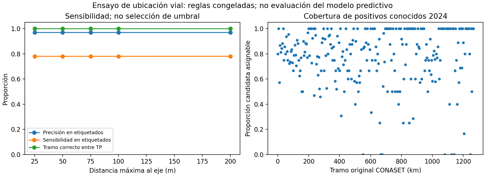

# Ensayo ejecutado de ubicación vial: resultado y decisión

Proyecto: **Predicción dinámica de siniestros en carreteras chilenas**.
Ejecución: 14/11/2026. Complementa el [procedimiento de ubicación vial](ubicacion_vial_2025.md)
y el [EDA de CONASET 2025](eda_conaset_2025.md).

**Resultado: no se admite aún la asignación automática de 2025.** El ensayo
recupera 2.033 de los 2.605 positivos conocidos de Ruta 5 Sur 2024 (78,04 %),
con precisión del 96,95 % entre candidatos con etiqueta conocida. No alcanza el
criterio de sensibilidad fijado antes del cálculo y siguen sin acreditarse la
vigencia cartográfica y la cobertura de vías urbanas competidoras. Se implementó y
ejecutó la comprobación; no se entrenó, recalibró ni cambió ningún modelo.

## Cartografía utilizada y dificultades de acceso

La consulta al servicio enlazado desde Descargas MOP, `Red_Vial_Chile`, falló con
ArcGIS 500 y después con tiempos de espera. La inspección del ZIP oficial comprobó
su cabecera ZIP, pero la lectura excedió el límite de 64 MiB: no se guardó ni se
utilizó el archivo incompleto. No se verificó su contenido o CRC.

Se realizó un ensayo independiente con la alternativa oficial ya inventariada,
[Red_Vial_Chile_ / capa 3](https://rest-sit.mop.gob.cl/arcgis/rest/services/VIALIDAD/Red_Vial_Chile_/MapServer/3).
No se mezclaron geometrías entre servicios. El cambio de fuente se registró en
un [protocolo alternativo](../config/protocolo_asignacion_vial_alternativa.json)
antes de calcular métricas, conservando todos los umbrales numéricos del
[protocolo inicial](../config/protocolo_asignacion_vial.json).
Las [incidencias de fuentes](../resultados/asignacion_vial/incidencias_fuentes.csv)
documentan lo que se pudo y no se pudo completar.

La descarga comprobó conteos y listas de identificadores iniciales/finales, lotes
sin truncamiento ni duplicación, respuesta WGS84 con M y sin Z, hashes y metadatos
iniciales/finales. El servicio no acredita con ello la fecha efectiva del trazado
ni la ausencia de ediciones intermedias de atributos.

- 79 entidades de Ruta 5 nacional; 33 reconocidas como candidatas del corredor sur
  por orientación o nombre. No se filtró exclusivamente ORIENTACION='SUR'.
- 1.218 entidades de otras vías que intersectan el corredor de aproximadamente
  2 km alrededor del eje sur. También se usaron como competidoras las piezas de
  Ruta 5 no clasificadas como sur. No equivale a un inventario completo de calles.
- 92.384 segmentos entre vértices del eje sur y 685.688 segmentos competidores.
- Las 33 entidades sur tienen M numérica en sus vértices. Ningún segmento sur
  incumple el control de coherencia local de M implementado. Los siete registros
  con KM_I/KM_F cero en el inventario anterior no implican por sí solos M ausente.

Originales comprobados: `data/fuentes/mop/asignacion_vial_alternativa_20261114/`,
unos 17 MiB comprimidos, fuera de Git. Se publican
[QA cartográfica](../resultados/asignacion_vial/cartografia.csv) y
[auditoría](../resultados/asignacion_vial/auditoria.json), con hashes y versiones.
No se declara que esta alternativa tenga una vigencia histórica acreditada.

## Reglas aplicadas sin ajuste sobre los resultados

Se utilizó Shapely 2.1.2 y pyproj 3.7.2. La respuesta del MOP se solicitó en WGS84;
las distancias se calcularon en UTM 19S (EPSG:32719), con orden explícito lon/lat.
Es una aproximación proyectada uniforme, no una certificación de precisión física;
parte del corredor queda al oeste de la zona nominal y la geocodificación también
tiene incertidumbre. El índice conserva cada segmento y parte por separado.

La propuesta de asignación solo recibe coordenadas; no recibe ruta o km del evento.
Se interpoló M en el segmento próximo y se usó M/1000 como escala candidata de km.
No se ajustó ningún desplazamiento de km a partir de 2024. No se rellenaron medidas
ausentes con KM_I/KM_F ni se conectaron partes discontinuas.

Los criterios del protocolo son decisiones propuestas para este ensayo, **no
exigencias del profesor**:

- Distancia máxima al eje: 75 m. La vía competidora debe quedar al menos 30 m más
  lejos que Ruta 5 Sur.
- Medidas de segmentos alternativos cercanos deben concordar dentro de 200 m.
  Se comparan los que están dentro del umbral y a no más de 30 m adicionales
  respecto del segmento elegido. Se conservan alternativas de ambas calzadas.
- Un evento a 50 m o menos de un borde kilométrico de 5 km queda ambiguo. Dominio:
  0 < km < 1.275. No se modificó el universo histórico del modelo.
- Medidas no finitas o incoherentes con la longitud local se anulan. Para arcos
  de más de 20 m se exige que |ΔM|/longitud proyectada esté entre 0,5 y 2,
  suponiendo provisionalmente metros; no es una validación de trazado o datum.
- Se fijó como puerta cuantitativa que los límites inferiores Wilson 95 % fueran
  ≥95 % en precisión, ≥90 % en sensibilidad y ≥90 % en tramo correcto condicional.
  También se exige acreditar vigencia y cobertura competidora urbana.

Los intervalos Wilson se usan como diagnóstico marginal por registro. La
independencia espacial/temporal no está acreditada; no son una garantía de calidad
en otras ubicaciones ni en registros sin etiqueta.

## Escala de M y límite de independencia

Se contrastó la escala con 5.583 eventos de Ruta 5 Sur 2020–2021, con km positivo,
fuera de la cuarentena histórica. Hubo 5.510 candidatos con M finita dentro del
radio diagnóstico de 200 m. M/1000 concuerda con el km registrado mucho mejor que
interpretar M directamente como km. Es compatibilidad empírica con los campos
históricos, no confirmación documental de unidad para cualquier otra capa.

El error mediano al usar M/1000 fue de aproximadamente 2,75×10⁻⁷ km. En los
positivos asignables de 2024 fue de 2,51×10⁻⁷ km, y la distancia mediana del conjunto
de positivos con candidato al eje fue de aproximadamente 0,000215 m. **No se
interpretan esas cifras como exactitud física submilimétrica de los siniestros.**

La coincidencia casi exacta es compatible con una ubicación construida mediante
geocodificación sobre un eje o kilometraje relacionado. Es una hipótesis que no
se confirmó para esta capa. El [portal geoespacial de CONASET](https://mapas-conaset.opendata.arcgis.com/)
describe geocodificación de registros y advierte del carácter referencial y de
posibles inconsistencias; no acredita aquí independencia de las etiquetas y
coordenadas. Debe documentarse cómo se generaron las coordenadas de 2025 antes de
extrapolar esta concordancia. Recuperar una codificación no valida por sí solo la
ubicación real de un evento nuevo.

## Comprobación nacional de 2024

Se procesaron los 72.043 registros de la instantánea del EDA. No se usaron los
eventos de 2025 para elegir reglas o calcular estas métricas. Las etiquetas se
reservaron para comprobar el resultado; se conservó la cuarentena existente
(ninguno de sus cinco ID pertenece a 2024).

| Grupo de referencia | Eventos |
|---|---:|
| RUTA 5 SUR exacta | 2.605 |
| Otra vía con etiqueta conocida | 12.163 |
| Ruta ausente, genérica o ambigua | 57.275 |

No se trataron los 57.275 desconocidos como negativos. La calidad se mide contra
etiquetas registradas, que tampoco son una verdad física independiente acreditada.

| Resultado a 75 m | Valor |
|---|---:|
| Positivos conocidos asignables (TP) | 2.033 |
| Otras vías conocidas propuestas como Ruta 5 Sur (FP) | 64 |
| Positivos conocidos sin asignación aceptable | 572 |
| Precisión entre asignables etiquetados: 2.033 / 2.097 | 96,95 % |
| Sensibilidad: 2.033 / 2.605 | 78,04 % |
| IC Wilson de precisión | 96,12–97,60 % |
| IC Wilson de sensibilidad | 76,41–79,59 % |
| Tramo concordante entre los 2.033 TP | 100 % |
| Propuestas asignables sin etiqueta verificable | 512 |
| Total de propuestas asignables, incluidos desconocidos | 2.609 |

El 100 % es condicional a haber aceptado esos positivos, y sujeto a la dependencia
de geocodificación descrita; no significa que se recuperara correctamente todo el
histórico. Los 512 desconocidos impiden conocer la precisión del conjunto completo
de 2.609 candidatos. Si todos fueran de otras vías o todos fueran Ruta 5 Sur,
respectivamente, la precisión quedaría entre aproximadamente 77,92 % y 97,55 %,
tomando las etiquetas conocidas como correctas. Son cotas por falta de etiqueta,
**no intervalos de confianza**. No se extrapola 96,95 % a 2025, donde faltan todas
las etiquetas viales.

Los 572 positivos sin asignación se distribuyen así:

| Motivo | Eventos |
|---|---:|
| Cerca del borde de tramo | 433 |
| Otra vía demasiado cercana | 106 |
| Sin candidato dentro de 75 m | 31 |
| Medidas alternativas incompatibles | 2 |

La sensibilidad varía por región: aproximadamente 72,96 % en Biobío y 84,68 % en
Metropolitana, entre las regiones con positivos. No existe una cobertura uniforme
por tramo. Aumentar el umbral de distancia a 200 m eleva los TP de 2.033 a 2.034 y
los candidatos sin etiqueta de 512 a 734: no resuelve el problema principal.
Se informa esa sensibilidad sin escoger otro umbral ni relajar el borde después
de observar los resultados.



Tablas: [sensibilidad](../resultados/asignacion_vial/sensibilidad.csv),
[motivos](../resultados/asignacion_vial/estados.csv),
[regiones](../resultados/asignacion_vial/por_region.csv),
[tramos](../resultados/asignacion_vial/por_tramo.csv) y
[escala de M](../resultados/asignacion_vial/control_escala.csv).

## Decisión y trabajo pendiente real

La puerta falla por sensibilidad, vigencia cartográfica no acreditada y cobertura
urbana competidora no acreditada. No se generaron propuestas de 2025. Tampoco se
convirtió un evento ambiguo o rechazado en un cero de siniestros para entrenar.
Los originales, las cinco cuarentenas, UTC/DST, particiones y modelos se conservan.

Para una nueva iteración se necesita:

1. Acreditar la versión del trazado y sus medidas, recuperando el servicio preferido
   o una descarga oficial completa con metadatos; no basta el nombre de un ZIP.
2. Acreditar cómo se geocodificaron 2024/2025 y obtener controles independientes o
   microdatos 2025 con ruta/km originales. No se enviaron solicitudes a instituciones.
3. Revisar bordes, enlaces y falsos positivos con información adicional que permita
   resolverlos. No eliminar el margen de 50 m solo para aumentar una métrica.
4. Si se cambian reglas usando los errores de 2024, tratar 2024 como diagnóstico de
   desarrollo de esa nueva versión y comprobarla después con otros controles
   reservados. No presentar otra iteración ajustada sobre 2024 como test intacto.

Esta decisión afecta la ampliación con ubicaciones inferidas de 2025; no invalida
por sí sola el experimento anterior, que usa ruta y kilómetro registrados y conserva
sus propias limitaciones. No se ha validado todavía el piloto operativo de 12 horas.

## Reproducción y archivos locales

Instalar el complemento espacial sobre el entorno del proyecto:

```bash
.venv/bin/python -m pip install -r requirements-espacial.txt
```

Para repetir el cálculo con las fuentes ya conservadas, sin volver a descargar:

```bash
OMP_NUM_THREADS=2 OPENBLAS_NUM_THREADS=2 MPLCONFIGDIR=/tmp/siniestros-matplotlib .venv/bin/python proyecto.py evaluar_asignacion_vial --protocolo config/protocolo_asignacion_vial_alternativa.json --geometria data/fuentes/mop/asignacion_vial_alternativa_20261114 --conaset data/fuentes/conaset/eda_2025_20261114_completa
```

Si no existen los originales cartográficos, crear una instantánea nueva (la fuente
puede cambiar) y usarla después con `--geometria`. No sobrescribir la revisión:

```bash
.venv/bin/python proyecto.py descargar_eje_mop --protocolo config/protocolo_asignacion_vial_alternativa.json --salida data/fuentes/mop/asignacion_vial_nueva
```

Los eventos con candidatos de 2024 y el control 2020–2021 están en
`data/fuentes/mop/derivados_asignacion_20261114/`, comprimidos y fuera de Git.
La auditoría registra sus hashes; no se publican filas individuales. Para una
revisión nueva usar también `--salida` y `--derivados` distintos. Nueve pruebas
nuevas comprueban M, discontinuidades, vías y medidas ambiguas, bordes, blancos,
truncamiento, denominadores y mezcla de propuestas previas. Las pruebas espaciales se omiten explícitamente
si falta el complemento; el entorno de esta ejecución sí lo incluye.
