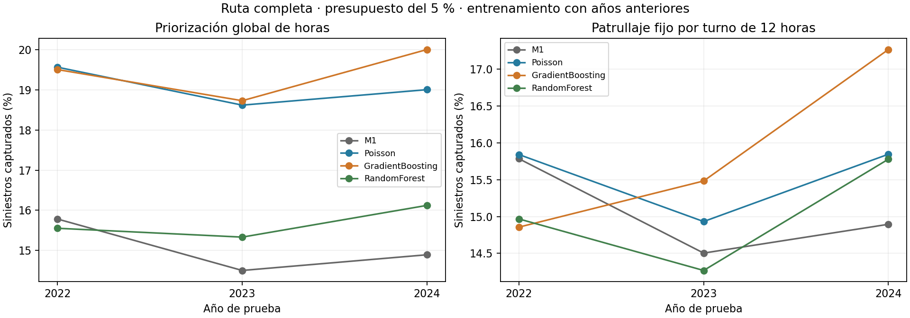
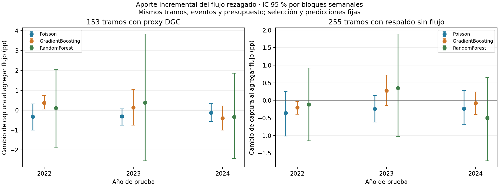
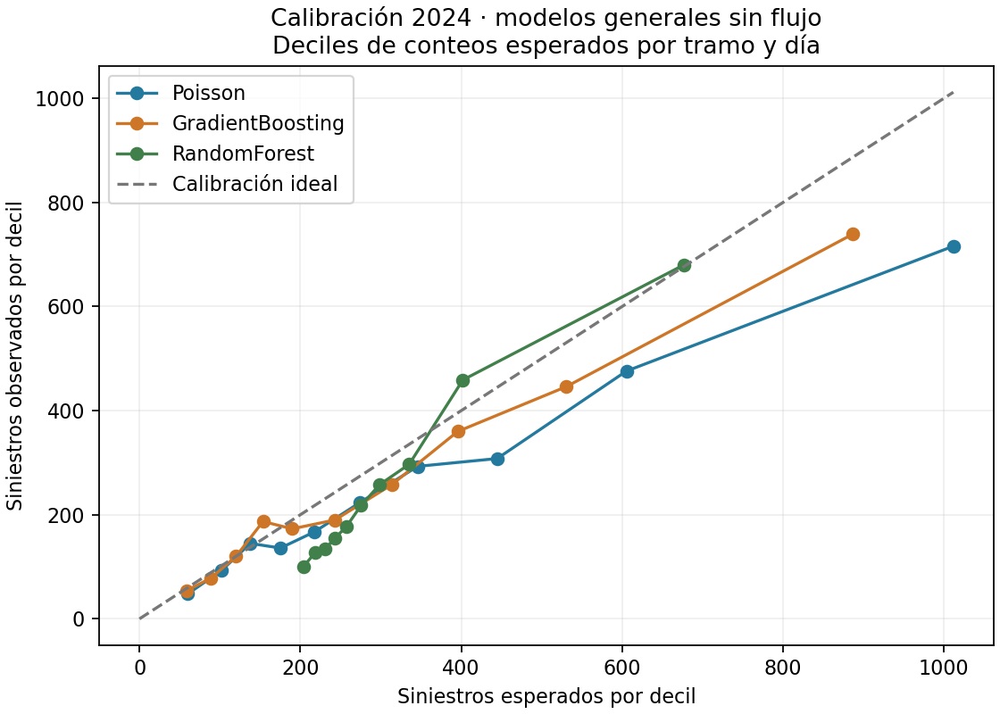

<!-- INICIO_MODELOS_ENTREGA3 -->
### Entrenamiento posterior al EDA: modelos con flujo vehicular

**Actualización: 12 de noviembre de 2026.** Se completó la comparación de Poisson,
Gradient Boosting y Random Forest con datos depurados, ERA5, calendario y proxy de
flujo DGC rezagado. El notebook y la presentación quedan para la etapa final.
La población de este experimento es **14.420 siniestros y 255 tramos**: se mantienen las
fuentes originales y se ponen en cuarentena las cinco discordancias espaciales del EDA.
Se usa un umbral de 25 km respecto de la referencia histórica; los umbrales de 5 y
10 km del EDA señalaban los mismos cinco registros. No se corrige su ubicación por
suposición. Los experimentos anteriores de 14.425
registros se conservan; sus puntuaciones no son comparaciones directas con esta corrida.

#### Incorporación del flujo y cambios de código

- [integrar_flujo.py](../../integrar_flujo.py) documenta intervalos interiores de seis contratos
  de Ruta 5, excluye baipases de kilometraje propio, fronteras inciertas y aplica margen
  de 1 km. Fuentes y páginas están en [limites_documentados.csv](limites_documentados.csv).
  Es una asignación de contexto por contrato; no acredita flujo uniforme por tramo.
- Se incorporan dos atributos: logaritmo del proxy diario de pasadas por punto de cobro
  y logaritmo del número implícito de puntos, ambos de **dos trimestres antes**.
  El segundo controla parcialmente cambios de composición; no verifica físicamente las plazas.
  Se normalizan a entero únicamente residuos ≤`1e-6` en puntos inferidos: el error
  máximo encontrado fue `7,3e-9`. Se conserva `puntos_implicitos_crudos` y cualquier
  fracción real. Así los árboles no aprenden cortes artificiales entre 4 y 4+`1e-9`.
  Se extraen también 2018–2019 de los XLS originales para tener rezagos reales desde 2020.
  Nunca se usa el flujo del trimestre a predecir ni se completan huecos con cero.
- Hay serie completa para **153/255 tramos (60 %)**; en 2024 contienen **1.491/2.605
  siniestros (57,24 %)**. Santiago–Talca/Acceso Sur, Chiloé y las celdas excluidas quedan
  fuera del experimento directo con flujo. El modelo híbrido usa un especialista en los
  tramos cubiertos y un modelo general sin flujo en los demás, con respaldo si falta el dato.
- PNCV continúa separado: sus estaciones parciales, ceros sin interpretar y falta de año
  2020 no se convierten en una exposición completa. `exposicion_validada.csv` permanece
  vacía. **Se modelan conteos; no se estima riesgo por vehículo-km.**
- [datos_modelado.py](../../datos_modelado.py) alinea las fuentes, mantiene la referencia espacial
  de 2020–2021, verifica las celdas del caché ERA5 tras la cuarentena y conserva exposición
  horaria 0/1/2 por horario de verano. La agrupación conserva conteos y exposición.
- [modelos_conteo.py](../../modelos_conteo.py) implementa las tres familias con pérdida/criterio
  Poisson. La regresión incluye offset horario y penalización L2; GB usa categorías nativas;
  RF usa categorías codificadas, 80 árboles y un máximo de 80.000 filas agrupadas por árbol.
  GB/RF ajustan tasa con peso igual a exposición y luego recuperan el conteo esperado.
  Sus tamaños de hoja y muestreo operan sobre filas agrupadas, no sobre horas individuales.
  Se aplica un piso de tasa de `1e-12` para calcular desvianza finita en hojas con cero.

#### Protocolo temporal y selección

Se comparan M0 uniforme, M1 espacial y las familias propuestas. En la cohorte de flujo,
cada familia tiene calendario → calendario+lluvia → calendario+lluvia+flujo sobre las
mismas filas. Incluyen tramo, hora, día de semana, mes, posición de feriado y tendencia
numérica anual; las variantes agregan lluvia y flujo. Las transformaciones se ajustan
solo con entrenamiento. No se usa una categoría de año futuro sin aprender.

1. Prueba 2022: entrenamiento 2020–2021, configuración simple prefijada.
2. Prueba 2023: entrenamiento 2020–2022, configuración elegida con 2022.
3. Prueba 2024: entrenamiento 2020–2023, configuración elegida con 2022 y 2023.

Se evalúan dos configuraciones por familia en los años previos, con preferencia por la
más simple a ≤0,1 puntos de captura del mejor promedio. La elección entre soluciones
para toda la ruta también usa exclusivamente las puntuaciones de 2022/2023.
**Candidata resultante: `Poisson_clima`**. La grilla, parámetros elegidos, años usados,
diagnósticos, versiones y hashes están en [auditoria.json](auditoria.json).

| Solución | Promedio captura 2022/2023 |
|---|---|
| GradientBoosting_clima | 19,11 % |
| Hibrido_GradientBoosting_clima | 18,81 % |
| Hibrido_GradientBoosting_clima_flujo | 18,85 % |
| Hibrido_Poisson_clima | 19,08 % |
| Hibrido_Poisson_clima_flujo | 18,78 % |
| Hibrido_RandomForest_clima | 15,79 % |
| Hibrido_RandomForest_clima_flujo | 15,90 % |
| M1 | 15,14 % |
| Poisson_clima | 19,09 % |
| RandomForest_clima | 15,44 % |

2024 ya se había inspeccionado en las entregas y el EDA: se informa como evaluación
histórica reutilizada, no como prueba intacta. Los intervalos usan 2.000 remuestreos
semanales pareados, manteniendo fijas predicciones y selección; no incorporan incertidumbre
del reentrenamiento ni corrigen comparaciones múltiples.

#### Resultados: ruta completa, prueba histórica de 2024

| Modelo | Captura 5 % | Captura por turno | Observado/esperado | MAE por turno |
|---|---|---|---|---|
| M1 | 14,89 % | 14,89 % | 0,88 | 1,8613 |
| M0 | 5,00 % | 5,00 % | 0,88 | 1,8613 |
| Poisson_clima | 19,00 % | 15,84 % | 0,77 | 1,9703 |
| GradientBoosting_clima | 20,00 % | 17,26 % | 0,87 | 1,7518 |
| RandomForest_clima | 16,12 % | 15,78 % | 0,83 | 1,8615 |

La candidata `Poisson_clima` captura **19,00 %** de
los siniestros con el 5 % del presupuesto global, frente a **14,89 %**
de M1. Su captura con patrullaje fijo por turno es **15,84 %**.
Son decisiones distintas: la priorización global permite cambiar tramo cada hora;
la métrica por turno fija los tramos durante 12 horas de reloj local. Observado/esperado
cercano a 1 indica mejor calibración agregada; no garantiza calibración por segmento.
El MAE compara el total de siniestros de la cohorte por turno de 12 horas.
Las métricas train/prueba, captura al 5/10/20 %, desvianza y MAE se conservan completas en
[metricas.csv](metricas.csv).
Diferencia frente a M1: 4,11 pp, IC 95 % [2,10; 6,08] pp.


Comparación train/prueba con la misma definición de captura:

| Modelo | Captura train (2020–2023) | Captura prueba (2024) | Brecha (pp) |
|---|---|---|---|
| GradientBoosting_clima | 26,01 % | 20,00 % | 6,01 |
| Poisson_clima | 21,72 % | 19,00 % | 2,72 |
| RandomForest_clima | 20,25 % | 16,12 % | 4,12 |

La brecha es un diagnóstico de generalización, no una prueba aislada de sobreajuste:
también cambian las frecuencias entre años. La elección se basa en evaluación temporal,
no en la captura obtenida durante el entrenamiento.



#### Aporte específico del flujo

Comparación 2024 sobre los mismos 153 tramos cubiertos (captura global y por turno al 5 %):

| Familia | Sin flujo | Con flujo | Turno sin flujo | Turno con flujo |
|---|---|---|---|---|
| Poisson | 17,51 % | 17,37 % | 15,03 % | 15,12 % |
| GradientBoosting | 18,85 % | 18,44 % | 16,06 % | 15,99 % |
| RandomForest | 15,36 % | 15,02 % | 13,62 % | 14,54 % |

La integración en toda la ruta tiene su propia comparación (255 tramos, captura al 5 %):

| Familia | General sin flujo | Híbrido sin flujo | Híbrido con flujo |
|---|---|---|---|
| Poisson | 19,00 % | 19,19 % | 18,96 % |
| GradientBoosting | 20,00 % | 20,31 % | 20,23 % |
| RandomForest | 16,12 % | 16,51 % | 16,01 % |

El híbrido sin flujo controla el efecto de entrenar un especialista en la cohorte
cubierta. Una mejora dentro de los 153 tramos no garantiza una mejora del ranking
entre todos los tramos; también interviene la escala relativa de sus predicciones.

Diferencia **clima+flujo menos clima**, sin confundirla con el aporte de la lluvia:

| Año | Familia | Cambio de captura (pp) | IC 95 % (pp) |
|---|---|---|---|
| 2022 | Poisson | -0,32 | [-1,01; 0,31] |
| 2022 | GradientBoosting | 0,37 | [0,06; 0,74] |
| 2022 | RandomForest | 0,11 | [-1,90; 2,05] |
| 2023 | Poisson | -0,32 | [-0,75; 0,06] |
| 2023 | GradientBoosting | 0,13 | [-0,76; 1,03] |
| 2023 | RandomForest | 0,38 | [-2,54; 3,82] |
| 2024 | Poisson | -0,13 | [-0,58; 0,34] |
| 2024 | GradientBoosting | -0,40 | [-1,01; 0,21] |
| 2024 | RandomForest | -0,34 | [-2,42; 1,86] |

Un intervalo que incluye cero no permite sostener una mejora clara en ese año.
No se da por útil el flujo solo por haberlo añadido; también puede reducir la captura.
Las comparaciones equivalentes para el híbrido de toda la ruta y contra M1 se guardan
en [bootstrap.csv](bootstrap.csv).




#### Recalibración de conteos con información previa

Para la candidata seleccionada se evalúa también multiplicar todos los conteos por el
cociente observado/esperado fuera de muestra del año anterior. Se mantiene fijo el
protocolo: 2023 usa el factor de 2022 y 2024 el de 2023. No se elige entre original y
recalibrado mirando el año objetivo. Un factor global positivo conserva el ranking,
la captura global y la captura por turno; sí cambia el volumen esperado y su MAE.

| Año | Variante | Año del factor | Factor | Observado/esperado | MAE por turno |
|---|---|---|---|---|---|
| 2023 | original | — | 1,0000 | 0,67 | 2,5360 |
| 2023 | recalibrado | 2022 | 0,6932 | 0,96 | 1,7840 |
| 2024 | original | — | 1,0000 | 0,77 | 1,9703 |
| 2024 | recalibrado | 2023 | 0,6687 | 1,15 | 1,6839 |

El ajuste puede mejorar o empeorar según el año; no demuestra estabilidad operativa.
Esta comparación es retrospectiva para la candidata elegida con 2022/2023, y la fila de
2023 forma parte del período usado para elegirla. Resultados completos en
[recalibracion_candidato.csv](recalibracion_candidato.csv).


#### Artefactos, reproducción y límites pendientes

Se guardaron modelos por año, cohorte y variante en `resultados/modelos/artefactos/`
(archivos locales ignorados por Git). Los evaluados en 2024 solo se ajustaron hasta 2023.
Se reajustó `Poisson_clima` con 2020–2024, conservando la elección y parámetros
anteriores a 2024. Su artefacto está en `resultados/modelos/artefactos/candidato_reajustado2020_2024.joblib`;
se verificaron 1000 predicciones reales idénticas al recargarlo.
Este reajuste no tiene evaluación futura y no sustituye el modelo del prototipo.
Se conserva además una variante recalibrada con el O/E fuera de muestra de 2024
en `candidato_reajustado2020_2024_recalibrado_con2024.joblib`; tampoco tiene evaluación futura.

Con las fuentes descargadas, ejecutar desde la raíz del repositorio:

```bash
OMP_NUM_THREADS=2 OPENBLAS_NUM_THREADS=2 .venv/bin/python entrenar_comparacion.py
OMP_NUM_THREADS=2 OPENBLAS_NUM_THREADS=2 .venv/bin/python reajustar_candidato.py
MPLCONFIGDIR=/tmp/siniestros-matplotlib .venv/bin/python resumir_modelos.py --actualizar-readme
OMP_NUM_THREADS=2 OPENBLAS_NUM_THREADS=2 .venv/bin/python -m unittest discover -s tests -v
```

**Comprobación de la corrida del 12 de noviembre: 33 pruebas pasaron.** Incluyen captura con empates y presupuesto,
UTC/DST, calendario fuera de cobertura, calidad de fuentes, fronteras de contratos,
rezago temporal, selección sin usar el año de prueba y persistencia de las tres familias.
La prueba nueva comprueba que se eliminan residuos numéricos de puntos de cobro sin
redondear fracciones reales. Se repitieron las variantes de flujo después de esta
corrección con [reentrenar_flujo.py](../../reentrenar_flujo.py), verificando hashes antes de
conservar los ajustes sin flujo. La corrida completa desde cero ya incluye el arreglo.

Siguen abiertas la validación con pronósticos meteorológicos emitidos en el pasado,
la fecha real de disponibilidad de los anexos DGC y la exposición vehicular por tramo.
El rezago de dos trimestres deja un trimestre completo desde el cierre de medición,
pero no acredita cuándo se publicó cada dato; los anexos actuales pueden contener revisiones.
Estos modelos respaldan una evaluación retrospectiva de conteos, no un servicio operativo
validado ni una interpretación causal del flujo. El calendario y las fuentes deben
actualizarse antes de una predicción fuera de 2020–2024.

La bitácora del EDA que sigue conserva las decisiones y pendientes de esa etapa.
Esta sección documenta su tratamiento posterior. No se modificaron notebook ni presentación.
<!-- FIN_MODELOS_ENTREGA3 -->
